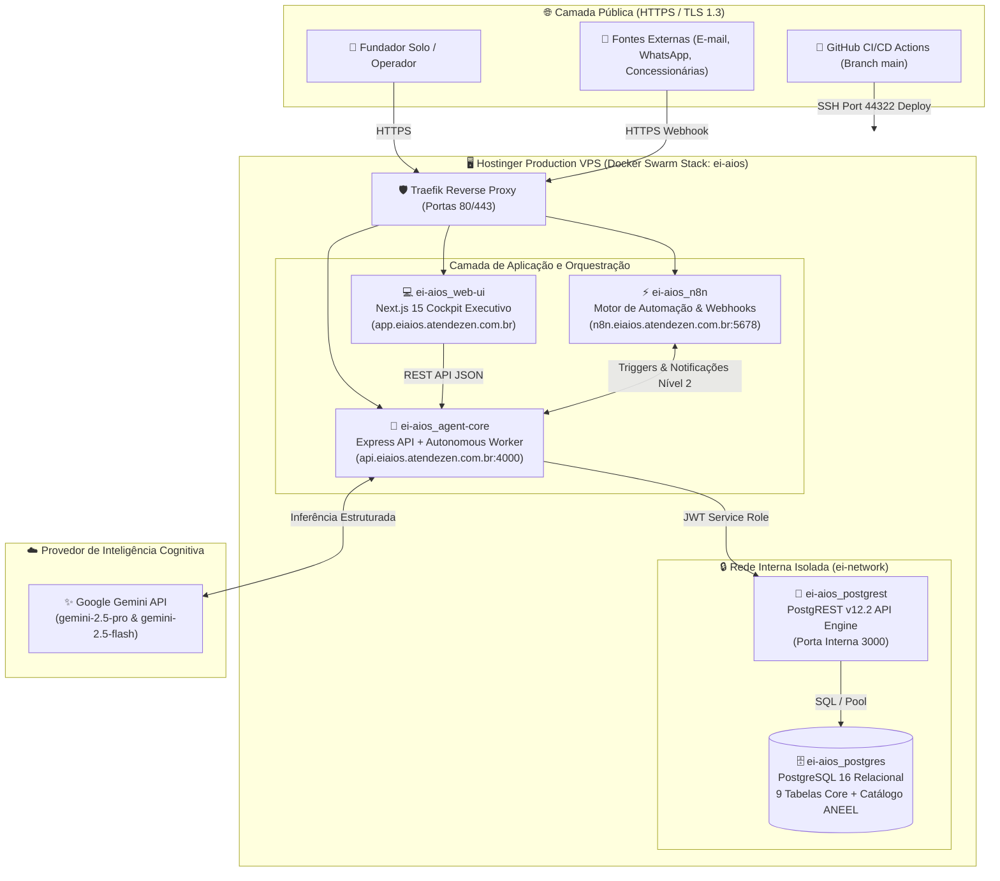
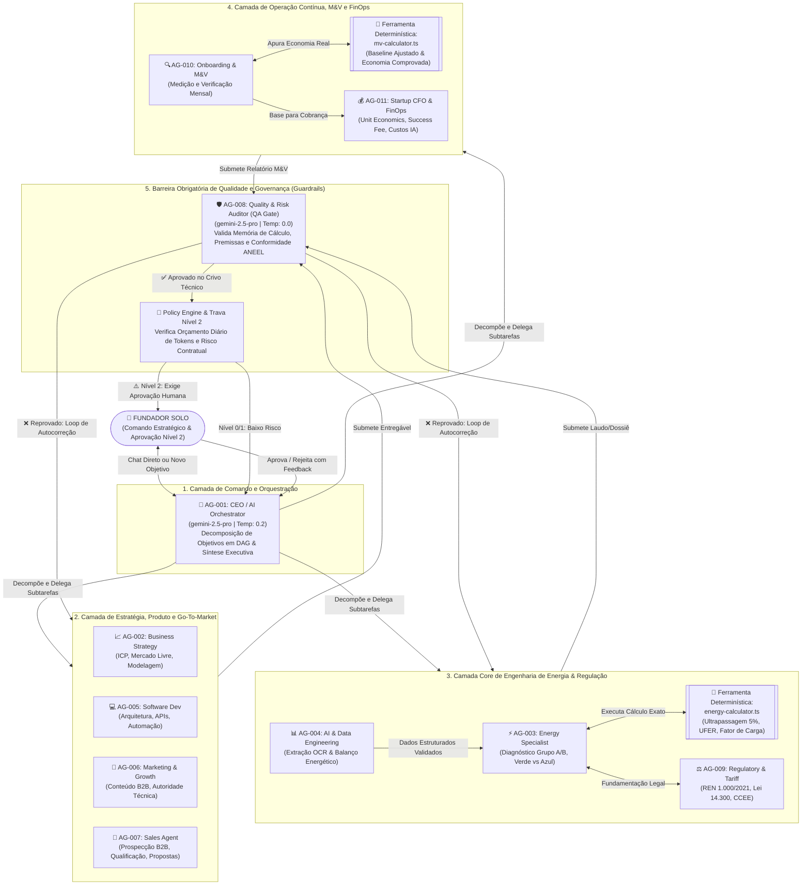
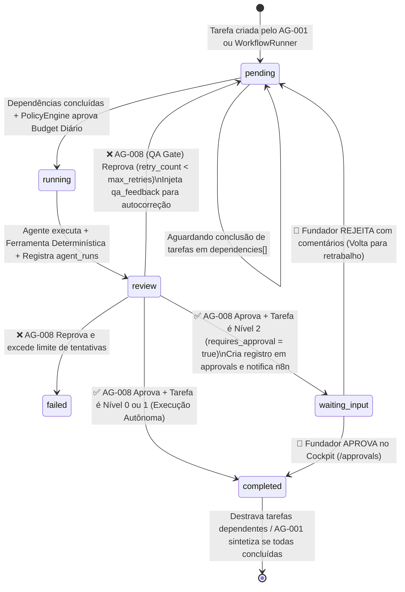

# Manual Oficial de Operação e Topologia Arquitetural — Energy Intelligence AIOS (EI-AIOS)

> **Versão:** 1.0.0 (Produção)  
> ** Domínios Oficiais:**  
> - **Cockpit Executivo (Web UI):** [https://app.eiaios.atendezen.com.br](https://app.eiaios.atendezen.com.br)  
> - **Motor de Agentes (Agent Core API):** [https://api.eiaios.atendezen.com.br](https://api.eiaios.atendezen.com.br)  
> - **Barramento de Automações (n8n):** [https://n8n.eiaios.atendezen.com.br](https://n8n.eiaios.atendezen.com.br)

---

## Sumário Executivo

O **Energy Intelligence AIOS (EI-AIOS)** é um Sistema Operacional de Inteligência Artificial projetado para permitir que um **Fundador Solo** opere uma startup de inteligência e eficiência energética em escala corporativa. 

A plataforma combina **11 agentes de IA especializados** (baseados nos modelos *Gemini 2.5 Pro* e *Gemini 2.5 Flash*) com **motores de cálculo determinísticos auditáveis** (em estrita conformidade com a **REN ANEEL nº 1.000/2021** e **Lei nº 14.300/2022**), governados por um crivo obrigatório de auditoria de qualidade (**QA Gate — AG-008**) e travas de aprovação humana (**Human-in-the-Loop Nível 2**).

---

## 1. Topologia da Plataforma e Infraestrutura em Produção

A plataforma opera em uma arquitetura de microsserviços conteinerizados em cluster **Docker Swarm**, protegida por proxy reverso **Traefik** com terminação SSL/TLS automática e rede interna isolada (`ei-network`) para comunicação de banco de dados.

### 1.1 Diagrama de Topologia da Infraestrutura



### 1.2 Componentes da Arquitetura Técnica

| Serviço Swarm | Tecnologia | Papel Arquitetural |
| :--- | :--- | :--- |
| **`ei-aios_web-ui`** | Next.js 15 (App Router) + Tailwind | Cockpit executivo em *Dark Mode* para conversação direta, gestão de tarefas, aprovações Nível 2 e métricas FinOps. |
| **`ei-aios_agent-core`** | Node.js 22 + TypeScript + Express | Coração do sistema: hospeda a API REST, o `AutonomousWorker` (polling a cada 5s), o `Orchestrator`, o `QAGate`, o `PolicyEngine` e as ferramentas determinísticas (`energy-calculator` e `mv-calculator`). |
| **`ei-aios_postgrest`** | PostgREST v12.2 | Camada de abstração de dados de alta performance compatível com o SDK `@supabase/supabase-js`, validando tokens JWT HS256 (`service_role` e `anon`). |
| **`ei-aios_postgres`** | PostgreSQL 16 Alpine | Persistência relacional transacional: armazena `agents`, `clients`, `consumer_units`, `energy_bills`, `tasks`, `agent_runs`, `approvals`, `artifacts` e `knowledge_sources`. |
| **`ei-aios_n8n`** | n8n Workflow Engine | Orquestrador de eventos externos: captura contas por e-mail/webhook, dispara auditorias no `agent-core` e envia alertas de aprovação ao fundador. |

---

## 2. Topologia Interna dos 11 Agentes (Arquitetura Cognitiva)

Os 11 agentes do EI-AIOS não operam de forma caótica ou isolada. Eles seguem uma **topologia hierárquica em grafo direcionado acíclico (DAG)**, onde **nenhum cálculo financeiro ou tarifário é feito por adivinhação do modelo de linguagem (LLM)**, e **nenhum entregável chega ao fundador sem passar pelo Auditor de Qualidade (AG-008)**.

### 2.1 Diagrama da Topologia de Comando, Execução e Governança dos Agentes



---

### 2.2 Matriz Detalhada dos 11 Agentes

| ID | Nome do Agente | Modelo Padrão | Temp. | Teto Diário | Ferramentas e Responsabilidades Exclusivas | Gatilho de Trava Nível 2 (`requires_approval`) |
| :---: | :--- | :---: | :---: | :---: | :--- | :--- |
| **`AG-001`** | **CEO / AI Orchestrator** | `gemini-2.5-pro` | `0.2` | \$15.00 | `decompose_objective`, `synthesize_results`. Decompõe metas do fundador em subtarefas atômicas com dependências (`DAG`) e consolida resumos executivos. | Publicação externa e compromissos financeiros. |
| **`AG-002`** | **Business Strategy Agent** | `gemini-2.5-pro` | `0.3` | \$8.00 | `market_analysis`, `icp_evaluator`. Define ICP (indústrias, supermercados, condomínios), analisa concorrentes e modela receitas (SaaS + Success Fee). | Nível 0/1 (Consultivo interno). |
| **`AG-003`** | **Energy Specialist Agent** | `gemini-2.5-pro` | `0.1` | \$12.00 | `energy_calculator`, `load_profile_analyzer`. Audita faturas Grupo A/B, avalia migração Horossazonal Verde vs Azul, ultrapassagem de demanda e fator de potência. | Emissão de laudo técnico oficial ao cliente. |
| **`AG-004`** | **AI & Data Engineering** | `gemini-2.5-flash` | `0.0` | \$10.00 | `bill_parser`, `tariff_validator`. Extrai dados de PDFs/imagens de faturas, valida soma de itens vs total da conta e detecta anomalias de leitura. | Nível 0 (Processamento interno de dados). |
| **`AG-005`** | **Software Development** | `gemini-2.5-pro` | `0.1` | \$10.00 | `code_generator`, `schema_validator`. Projeta APIs, esquemas SQL, integrações n8n e melhorias técnicas nos módulos da plataforma. | Deploy em produção e migração de banco. |
| **`AG-006`** | **Marketing & Growth** | `gemini-2.5-flash` | `0.4` | \$5.00 | `content_creator`, `case_study_builder`. Cria artigos técnicos sobre tarifas, estudos de caso de economia real e materiais educativos B2B. | Publicação externa em redes ou blog. |
| **`AG-007`** | **Sales Agent** | `gemini-2.5-flash` | `0.3` | \$6.00 | `proposal_generator`, `lead_qualifier`. Qualifica leads pelo valor da fatura e tensão, estrutura cadências comerciais e redige propostas de piloto (LOI). | Envio de proposta comercial ou desconto. |
| **`AG-008`** | **Quality & Risk (Auditor QA)** | `gemini-2.5-pro` | `0.0` | \$12.00 | `qa_evaluator`, `compliance_checker`. **Crivo obrigatório.** Reprova imediatamente qualquer resposta com números sem memória de cálculo ou promessa de "economia garantida". | Pode elevar qualquer tarefa para Nível 2. |
| **`AG-009`** | **Regulatory & Tariff** | `gemini-2.5-pro` | `0.1` | \$8.00 | `regulatory_search`, `aneel_dossier_builder`. Domina a REN ANEEL 1.000/2021, Lei 14.300/2022 (GD) e CCEE. Fundamenta pedidos de restituição em dobro. | Protocolo de petição/contestação na distribuidora. |
| **`AG-010`** | **Onboarding & M&V Agent** | `gemini-2.5-flash` | `0.1` | \$6.00 | `mv_calculator`, `retention_reporter`. Compara fatura mensal pós-otimização com a linha de base (*baseline*) ajustada e comprova a economia real gerada. | Envio de relatório mensal de medição ao cliente. |
| **`AG-011`** | **Startup CFO & FinOps** | `gemini-2.5-flash` | `0.1` | \$6.00 | `finops_calculator`, `saas_metrics`. Calcula MRR, ARPA, CAC, LTV, margem bruta descontando o gasto de tokens (`agent_runs`) e fatura o *Success Fee*. | Faturamento ao cliente e reajuste financeiro. |

---

## 3. Ciclo de Vida Interno de uma Tarefa (State Machine)

Quando você cria um objetivo ou dispara um workflow, o `AutonomousWorker` (que roda continuamente em segundo plano a cada 5 segundos no `agent-core`) processa cada tarefa seguindo este fluxo de estados rigoroso:



> [!IMPORTANT]
> **Por que essa arquitetura é segura para o setor elétrico?**  
> 1. **Zero Alucinação Matemática:** O `AG-003` e o `AG-010` recebem no prompt os cálculos já processados pelos módulos TypeScript [`energy-calculator.ts`](file:///c:/_dev/ei-aios/packages/agent-core/src/tools/energy-calculator.ts) e [`mv-calculator.ts`](file:///c:/_dev/ei-aios/packages/agent-core/src/tools/mv-calculator.ts).  
> 2. **Dupla Barreira de Segurança:** Mesmo após o agente gerar o laudo, o `AG-008` inspeciona o JSON gerado. Se o agente prometer "economia garantida" sem ressalvas técnicas ou omitir premissas, o `AG-008` bloqueia a tarefa e força o agente a refazê-la automaticamente antes mesmo de incomodar você.

---

## 4. Guia Prático: Como Usar os Agentes no Dia a Dia

Existem **4 modos de operação** para você interagir com o seu time de 11 agentes. Abaixo está o roteiro completo de como usar cada um.

---

### Modo 1: Conversa Direta Síncrona (Consultoria Rápida 1-a-1)

Ideal para tirar dúvidas rápidas, pedir rascunhos de e-mail, consultar um artigo da ANEEL ou validar uma hipótese comercial diretamente com um especialista.

#### Pelo Cockpit Web:
1. Acesse **[https://app.eiaios.atendezen.com.br/agents](https://app.eiaios.atendezen.com.br/agents)**.
2. Escolha o agente especialista desejado e clique em **"Conversar com o Agente"**.
3. Na gaveta lateral (*Chat Drawer*), envie sua solicitação. O histórico da conversa é mantido na sessão e você vê em tempo real quantos tokens e frações de centavo de dólar foram gastos.

#### Exemplos de Prompts Profissionais por Agente:

* **Para o `AG-001` (CEO / Orchestrator):**
  > *"AG-001, estruture nosso plano operacional de 30 dias para conquistar os primeiros 3 clientes piloto do segmento de supermercados na área de concessão da CPFL Paulista."*
* **Para o `AG-002` (Business Strategy):**
  > *"AG-002, compare o modelo de cobrança 'SaaS Puro (R$ 490/mês)' versus 'SaaS Reduzido + 20% de Success Fee sobre economia comprovada' para indústrias de médio porte no Grupo A4."*
* **Para o `AG-003` (Energy Specialist):**
  > *"AG-003, um cliente do Grupo A4 (Horossazonal Verde) tem demanda contratada de 300 kW, mas registrou demanda medida de 345 kW no último mês e fator de potência indutivo de 0,84. Explique os impactos tarifários e quais medidas corretivas devemos propor."*
* **Para o `AG-007` (Sales Agent):**
  > *"AG-007, redija uma mensagem de abordagem executiva para o Diretor Financeiro de uma rede de supermercados com 5 lojas, oferecendo uma auditoria gratuita das últimas 12 faturas de energia sob regime de Success Fee."*
* **Para o `AG-009` (Regulatory & Tariff Intelligence):**
  > *"AG-009, quais são os requisitos e prazos da Resolução Normativa ANEEL nº 1.000/2021 para solicitar a devolução em dobro de valores faturados a maior por erro de enquadramento tarifário da concessionária?"*

#### Via API REST (cURL / Integrações):
```bash
curl -X POST https://api.eiaios.atendezen.com.br/api/v1/agents/AG-003/chat \
  -H "Content-Type: application/json" \
  -d '{
    "message": "Explique a diferença prática entre a Tarifa Horossazonal Verde e Azul para uma indústria que opera em dois turnos.",
    "history": []
  }'
```

---

### Modo 2: Orquestração Autônoma de Objetivos Macro (Top-Down com AG-001)

Ideal quando você tem uma meta complexa que exige o trabalho coordenado de vários agentes em sequência (ex: Estratégia $\rightarrow$ Engenharia $\rightarrow$ Regulatório $\rightarrow$ Comercial).

#### Como Executar:
1. Acesse **[https://app.eiaios.atendezen.com.br/tasks](https://app.eiaios.atendezen.com.br/tasks)** ou dispare via API no endpoint `POST /api/v1/objectives`.
2. Descreva o objetivo macro e a prioridade (`P0`, `P1`, `P2`, `P3`).

```bash
curl -X POST https://api.eiaios.atendezen.com.br/api/v1/objectives \
  -H "Content-Type: application/json" \
  -d '{
    "title": "Estruturação de Oferta de Auditoria de Demanda e Reativos para Indústrias Metalúrgicas",
    "description": "Mapear o perfil de consumo típico de metalúrgicas no Grupo A4, definir os parâmetros de auditoria de demanda e fator de potência, validar o embasamento na REN 1.000/2021 e criar a carta proposta comercial com modelo de Success Fee de 20%.",
    "priority": "P0"
  }'
```

#### O que acontece nos bastidores automaticamente:
1. O **`AG-001`** recebe seu objetivo e usa o modelo `gemini-2.5-pro` para quebrá-lo em subtarefas encadeadas (ex: Tarefa 1 para `AG-002` $\rightarrow$ Tarefa 2 para `AG-003` $\rightarrow$ Tarefa 3 para `AG-009` $\rightarrow$ Tarefa 4 para `AG-007`).
2. O **`AutonomousWorker`** detecta as tarefas pendentes a cada 5 segundos e executa a Tarefa 1.
3. Assim que a Tarefa 1 passa pelo **`AG-008` (QA Gate)**, a Tarefa 2 é destravada automaticamente, recebendo o contexto produzindo pela anterior.
4. Tarefas de Nível 2 (como a proposta comercial final do `AG-007`) pausam em `waiting_input` e aparecem na sua fila em **[https://app.eiaios.atendezen.com.br/approvals](https://app.eiaios.atendezen.com.br/approvals)**.
5. Quando todas as subtarefas terminam, o **`AG-001`** consolida tudo em um **Artefato Executivo Final** disponível em **[https://app.eiaios.atendezen.com.br/artifacts](https://app.eiaios.atendezen.com.br/artifacts)**.

---

### Modo 3: Auditoria Determinística de Faturas e Workflows de Produto (`WF-003`, `WF-007`, `WF-008`)

Este é o coração técnico da startup para entregar valor aos clientes finais.

#### A) Auditoria Imediata de Conta de Energia (Upload PDF/Imagem ou JSON)
Você pode enviar uma fatura real pela tela **[https://app.eiaios.atendezen.com.br/energy](https://app.eiaios.atendezen.com.br/energy)** ou via endpoint `POST /api/v1/bills/audit-upload`.

O motor determinístico [`energy-calculator.ts`](file:///c:/_dev/ei-aios/packages/agent-core/src/tools/energy-calculator.ts) executa instantaneamente:
1. **Auditoria de Demanda (`auditDemand`):** Verifica se a demanda medida ultrapassou o limite de tolerância de **5%** da demanda contratada (Grupo A), calculando a multa exata de ultrapassagem ($2 \times \text{Tarifa de Demanda}$) ou a ociosidade por sobrecontratação (> 20% ociosa).
2. **Fator de Carga (`calculateLoadFactor`):** Calcula $\text{FC} = \frac{\text{Consumo Total (kWh)}}{\text{Demanda Máxima (kW)} \times 730\text{h}}$ e classifica o perfil operacional da unidade.
3. **Auditoria de Energia Reativa (`auditReactivePower`):** Avalia o Fator de Potência frente ao limite regulatório de **0,92**, dimensiona o banco de capacitores necessário em $\text{kVAr}$ e calcula o *payback* estimado em meses.
4. **Simulação Horossazonal Verde vs. Azul (`compareGreenVsBlueModality`):** Compara matematicamente o custo anual na modalidade atual versus a modalidade alternativa, recomendando a opção mais econômica.

#### B) Disparo dos Workflows Padronizados (`POST /api/v1/workflows/trigger`)
A plataforma possui fluxos pré-configurados no [`workflow-runner.ts`](file:///c:/_dev/ei-aios/packages/agent-core/src/engine/workflow-runner.ts):

| Código | Nome do Workflow | Cadeia de Agentes Acionada |
| :---: | :--- | :--- |
| **`WF-003`** | **Diagnóstico Energético Automatizado (Core Product)** | `AG-004` (Validação da Fatura) $\rightarrow$ `AG-003` (Cálculo Determinístico + Laudo Técnico) $\rightarrow$ `AG-008` (Auditoria QA) $\rightarrow$ Aprovação Nível 2. |
| **`WF-007`** | **Dossiê de Contestação e Restituição ANEEL** | `AG-009` (Fundamentação na REN 1.000/2021 + Cálculo de Devolução em Dobro) $\rightarrow$ `AG-008` (Auditoria QA) $\rightarrow$ Aprovação Nível 2. |
| **`WF-008`** | **Fechamento Mensal de Economia (M&V e Cobrança)** | `AG-010` (Cálculo de Custo Evitado via `mv-calculator`) $\rightarrow$ `AG-011` (Apuração de Success Fee + Mensalidade SaaS) $\rightarrow$ `AG-008` $\rightarrow$ Aprovação Nível 2. |

**Exemplo de disparo do `WF-003` via API:**
```bash
curl -X POST https://api.eiaios.atendezen.com.br/api/v1/workflows/trigger \
  -H "Content-Type: application/json" \
  -d '{
    "workflowCode": "WF-003",
    "customObjective": "Auditoria completa da fatura de Outubro/2026 da Unidade Industrial Campinas",
    "payload": {
      "distributor": "CPFL Paulista",
      "tariffGroup": "A4",
      "currentModality": "VERDE",
      "contractedDemandOffPeakKw": 300,
      "measuredDemandOffPeakKw": 342,
      "measuredDemandPeakKw": 280,
      "consumptionOffPeakKwh": 95000,
      "consumptionPeakKwh": 18000,
      "powerFactor": 0.85,
      "reactiveExcessChargingBrl": 4250.00
    }
  }'
```

---

### Modo 4: Governança Humana (Aprovações Nível 2) e Controle FinOps

Como fundador solo, seu papel não é executar tarefas operacionais, mas **aprovar decisões críticas** e **monitorar a eficiência financeira dos agentes**.

1. **Central de Aprovações (`/approvals`):**
   - Acesse **[https://app.eiaios.atendezen.com.br/approvals](https://app.eiaios.atendezen.com.br/approvals)**.
   - Para cada tarefa em `waiting_input`, você verá o entregável gerado pelo agente e o parecer de auditoria do **`AG-008`**.
   - Se clicar em **Aprovar**, a tarefa vai para `completed` e destrava o restante do fluxo.
   - Se clicar em **Rejeitar**, você digita o motivo (ex: *"Inclua uma cláusula limitando o prazo de vigência para 12 meses"*). O sistema devolve a tarefa para `pending` injetando seu feedback no campo `founder_rejection_feedback`, e o agente refaz o trabalho automaticamente!

2. **Painel FinOps e Telemetria (`/finops`):**
   - Acesse **[https://app.eiaios.atendezen.com.br/finops](https://app.eiaios.atendezen.com.br/finops)** ou consulte `GET /api/v1/metrics/finops`.
   - Monitore em tempo real os **7 Indicadores Executivos**:
     1. Taxa de Conclusão de Tarefas (`completion_rate_percent`)
     2. Taxa de Retrabalho no QA Gate (`qa_rework_rate_percent`)
     3. Custo Médio de IA por Tarefa (`avg_cost_per_task_usd`)
     4. Tempo Médio de Execução (`avg_execution_time_ms`)
     5. Índice de Aprovação do Fundador (`approval_rate_percent`)
     6. Consumo de Tokens de Hoje e do Mês (`total_token_spend_usd_today` / `month`)
     7. Custo Médio por Artefato Oficial Emitido (`cost_per_artifact_usd`)

---

## 5. Referência Rápida de Endpoints da API (`api.eiaios.atendezen.com.br`)

| Método | Endpoint | Descrição |
| :---: | :--- | :--- |
| `GET` | `/health` | Verifica a saúde da API e o status do `AutonomousWorker`. |
| `GET` | `/api/v1/agents` | Lista o catálogo completo dos 11 agentes e suas configurações. |
| `POST` | `/api/v1/agents/:id/chat` | Conversa interativa em tempo real com qualquer agente (`AG-001` a `AG-011`). |
| `POST` | `/api/v1/objectives` | Envia um objetivo macro para decomposição pelo `AG-001` e execução em cadeia. |
| `POST` | `/api/v1/workflows/trigger` | Dispara um dos workflows padronizados (`WF-001` a `WF-008`). |
| `POST` | `/api/v1/bills/audit-upload` | Faz upload de fatura (PDF/Imagem ou dados) e executa a auditoria determinística completa. |
| `POST` | `/api/v1/approvals/:id/decide` | Aprova ou rejeita uma tarefa de Nível 2 (`approved` ou `rejected` com feedback). |
| `POST` | `/api/v1/worker/trigger` | Força um ciclo imediato de execução do Worker sem aguardar os 5 segundos. |
| `GET` | `/api/v1/metrics/finops` | Retorna os 7 indicadores operacionais e financeiros de consumo de IA. |
| `POST` | `/api/v1/system/clean-database` | Reseta todos os dados transacionais mantendo os 11 agentes e as normas ANEEL intactos. |

