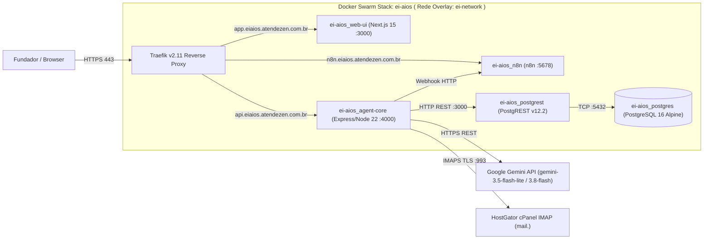
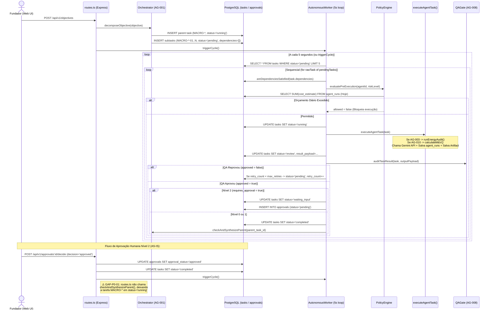
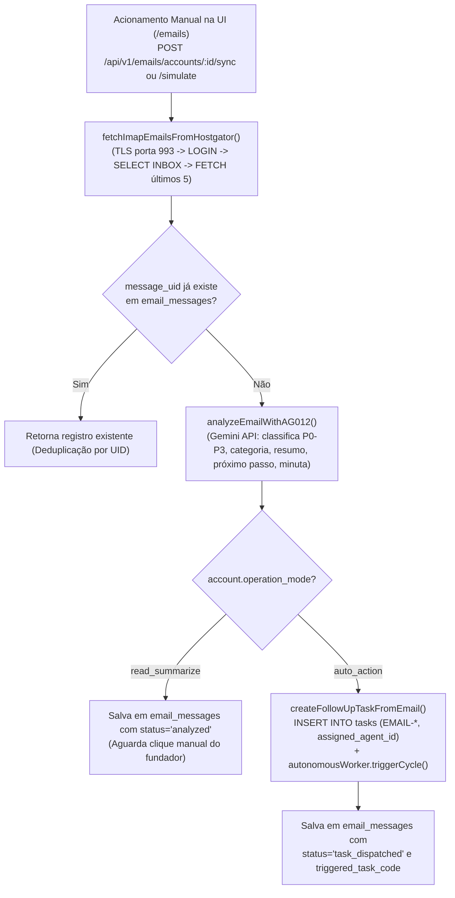
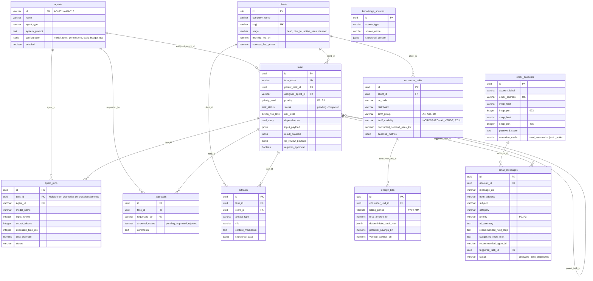

# ARQUITETURA ATUAL ENCONTRADA (AS-IS) — EI-AIOS

**Data de Levantamento:** 07/11/2026  
**Escopo:** Documentação fiel da arquitetura efetivamente implementada no repositório `c:\_dev\ei-aios` e em execução na VPS Hostinger (`187.77.49.211`).

---

## 1. Visão Geral dos Componentes (Monorepo NPM Workspaces)

O projeto está estruturado como um **Monorepo TypeScript (Node.js 22 LTS / ESM)** gerenciado via `npm workspaces` (`package.json` raiz), dividido em três pacotes principais e duas pastas de infraestrutura/banco:

```text
ei-aios/
├── packages/
│   ├── shared/                 # (@ei-aios/shared) Enums, Tipos e Schemas Zod compartilhados
│   │   └── src/
│   │       ├── enums.ts        # AgentId (AG-001 a AG-012), TaskStatus, PriorityLevel, ActionRiskLevel
│   │       ├── schemas.ts      # Schemas Zod (TaskEnvelope, OrchestratorPlan, EnergyBill, QAReview)
│   │       └── index.ts
│   ├── agent-core/             # (@ei-aios/agent-core) Backend API REST, Worker, Agentes e Tools
│   │   └── src/
│   │       ├── agents/
│   │       │   ├── registry.ts # Catálogo AG-001 a AG-012 + lookup na tabela agents
│   │       │   └── executors.ts# Executor central de tarefas + chamada de tools determinísticas
│   │       ├── api/
│   │       │   ├── routes.ts   # 21 endpoints REST (/api/v1/*)
│   │       │   └── server.ts   # Servidor Express (porta 4000)
│   │       ├── config/
│   │       │   ├── env.ts      # Variáveis de ambiente
│   │       │   ├── gemini.ts   # Cliente @google/genai + failover de modelos + telemetria agent_runs
│   │       │   └── supabase.ts # Cliente @supabase/supabase-js apontando para PostgREST
│   │       ├── engine/
│   │       │   ├── orchestrator.ts  # Decomposição (AG-001) e síntese executiva
│   │       │   ├── policy-engine.ts # Circuit Breaker FinOps diário e regra Nível 2
│   │       │   ├── qa-gate.ts       # Auditoria AG-008 + trava textual "economia garantida"
│   │       │   └── worker.ts        # Loop contínuo de polling de tarefas (5s)
│   │       └── tools/
│   │           ├── energy-calculator.ts # Calculadora determinística Grupo A (REN 1.000/2021)
│   │           ├── mv-calculator.ts     # Calculadora determinística M&V (IPMVP)
│   │           ├── bill-parser.ts       # Extrator multimodal de faturas (OCR via Gemini)
│   │           ├── artifact-writer.ts   # Persistência de artefatos em Markdown/JSON
│   │           └── email-intelligence.ts# Cliente IMAP TLS HostGator + triagem AG-012
│   └── web-ui/                 # (@ei-aios/web-ui) Cockpit Executivo em Next.js 15.5 (App Router)
│       └── src/
│           ├── app/            # Rotas: /, /tasks, /agents, /emails, /energy, /approvals, /artifacts, /clients, /finops
│           ├── components/     # ExecutiveDeliverableView.tsx (Renderizador corporativo)
│           └── lib/            # api-client.ts
├── supabase/
│   ├── migrations/
│   │   ├── 0001_core_schema.sql      # 11 tabelas + enums + índices
│   │   └── 0002_rls_and_triggers.sql # Triggers updated_at + RLS + índices GIN
│   └── seed.sql                      # Seed de AG-001 a AG-012, cliente piloto e knowledge_sources
└── docker/
    ├── docker-compose.yml      # Stack Docker Swarm (traefik, postgres, postgrest, agent-core, web-ui, n8n)
    └── deploy.sh               # Script de deploy e aplicação de migrations no Swarm
```

---

## 2. Topologia de Infraestrutura e Containers (AS-IS)

A plataforma roda em produção sob uma stack **Docker Swarm (`ei-aios`)** orquestrada atrás do proxy reverso **Traefik v2.11** com certificados TLS Let's Encrypt automáticos:



> **Observação Arquitetural Importante:** No ambiente atual, o pacote `@supabase/supabase-js` em `packages/agent-core/src/config/supabase.ts` conecta-se diretamente ao container **PostgREST standalone** (`http://postgrest:3000`), assinando um token JWT local com `role: 'service_role'` usando a variável `JWT_SECRET`. Não há container GoTrue (Supabase Auth) nem Kong API Gateway na stack Docker atual.

---

## 3. Fluxo Real de Orquestração e Execução de Tarefas (AS-IS)

O diagrama abaixo representa exatamente como o código atual (`orchestrator.ts`, `worker.ts`, `executors.ts`, `qa-gate.ts` e `routes.ts`) processa um objetivo macro ou tarefa:



---

## 4. Fluxo Real do `AG-012` — Inteligência de E-mails (AS-IS)



---

## 5. Modelo de Dados Real no PostgreSQL (11 Tabelas Existentes)

Todas as 11 tabelas abaixo estão fisicamente criadas no banco de dados PostgreSQL (`supabase/migrations/0001_core_schema.sql`):



---

## 6. Ferramentas Reais vs. Ferramentas Declaradas no `seed.sql`

Durante a auditoria, confrontamos as ferramentas listadas no campo `configuration.tools` de `supabase/seed.sql` com os módulos efetivamente implementados em `packages/agent-core/src/tools/`:

| Ferramenta Citada no `seed.sql` | Agente Associado | Status Real no Código (`packages/agent-core/src/tools/`) |
|---|---|---|
| `energy-calculator` (`energy_calculator`) | `AG-003` | **IMPLEMENTADO E INTEGRADO** (`energy-calculator.ts` -> chamado em `executors.ts:28` e `routes.ts:116`) |
| `mv-calculator` (`mv_calculator`) | `AG-010` | **IMPLEMENTADO E INTEGRADO** (`mv-calculator.ts` -> chamado em `executors.ts:43`) |
| `bill_parser` | `AG-004` | **IMPLEMENTADO PARCIALMENTE** (`bill-parser.ts` -> chamado em `routes.ts:108`, mas não em `executors.ts`) |
| `artifact_writer` | Todos | **IMPLEMENTADO E INTEGRADO** (`artifact-writer.ts` -> chamado em `executors.ts:106, 134`) |
| `imap_reader`, `next_step_analyzer`, `task_dispatcher` | `AG-012` | **IMPLEMENTADO E INTEGRADO** (`email-intelligence.ts` -> chamado em `routes.ts:724, 774, 899`) |
| `task_router`, `workflow_planner`, `executive_synthesizer` | `AG-001` | **IMPLEMENTADO EM `orchestrator.ts`** (via métodos `decomposeObjective` e `synthesizeCompletedObjective`) |
| `qa_validator`, `math_consistency_checker`, `compliance_scanner` | `AG-008` | **IMPLEMENTADO EM `qa-gate.ts`** (`auditTaskResult`) |
| `finops_calculator`, `saas_metrics` | `AG-011` | **NÃO IMPLEMENTADO COMO TOOL** (existe apenas agregação de tokens em `routes.ts:287`, sem módulo em `src/tools/`) |
| `data_validator` | `AG-004` | **NÃO IMPLEMENTADO** (apenas referenciado como string no JSON de seed) |
| `market_analyzer`, `swot_generator`, `icp_scorer` | `AG-002` | **NÃO IMPLEMENTADO COMO TOOL** (executado via prompt LLM genérico) |
| `code_generator`, `schema_designer` | `AG-005` | **NÃO IMPLEMENTADO COMO TOOL** (executado via prompt LLM genérico) |
| `copywriter`, `campaign_planner` | `AG-006` | **NÃO IMPLEMENTADO COMO TOOL** (executado via prompt LLM genérico) |
| `proposal_generator`, `lead_qualifier`, `loi_builder` | `AG-007` | **NÃO IMPLEMENTADO COMO TOOL** (executado via prompt LLM genérico) |
| `aneel_rag`, `dossier_writer` | `AG-009` | **NÃO IMPLEMENTADO COMO TOOL** (tabela `knowledge_sources` existe, mas não é consultada em `executors.ts`) |

---

## 7. Variáveis de Ambiente e Gerenciamento de Credenciais (Sem Exposição de Segredos)

Em `packages/agent-core/src/config/env.ts` e `.github/workflows/deploy.yml`, foram identificadas as seguintes variáveis de configuração:

| Variável | Presença em Produção | Finalidade | Observação de Auditoria |
|---|---|---|---|
| `GEMINI_API_KEY` | Presente (injetada via GitHub Secrets) | Autenticação na API Google Gemini (`@google/genai`) | Configurada e operacional (`mode: gemini_live_api`) |
| `GEMINI_DEFAULT_FAST_MODEL` | Presente (`gemini-3.5-flash-lite`) | Modelo padrão de baixa latência | Operacional com failover para `gemini-3.1-flash-lite` |
| `GEMINI_DEFAULT_REASONING_MODEL` | Presente (`gemini-3.8-flash`) | Modelo padrão para raciocínio complexo | Operacional |
| `SUPABASE_URL` | Presente (`http://postgrest:3000`) | Endpoint interno PostgREST na rede Docker Swarm | Operacional |
| `JWT_SECRET` | Presente | Assinatura de JWT `service_role` para o PostgREST | Operacional |
| `POSTGRES_PASSWORD` | Presente | Senha do banco PostgreSQL 16 interno | Operacional |
| `N8N_WEBHOOK_URL` | Presente | Notificação externa de aprovações Nível 2 | Operacional |

