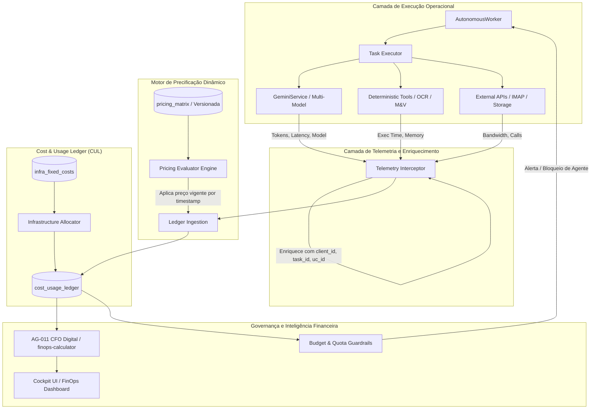

# EI-AIOS — ARQUITETURA ALVO DE FINOPS & OBSERVABILIDADE ECONÔMICA
## Design de Engenharia, Cost & Usage Ledger e Governança de Custos de IA e Infraestrutura

**Data:** 08/11/2026  
**Status:** Arquitetura Proposta para a Sprint 6  
**Autor:** Arquiteto de Sistemas Multiagentes & Especialista FinOps  
**Princípio Central:** *Zero Guesswork* — Cada centavo gasto na operação do EI-AIOS deve possuir um registro imutável, rastreável a um cliente, agente, tarefa ou infraestrutura compartilhada.

---

## 1. Visão Geral da Arquitetura Alvo

A arquitetura alvo de FinOps introduz uma camada de governança econômica centralizada, conectando a telemetria técnica de baixo nível diretamente aos modelos de Unit Economics do **AG-011 (CFO Digital)**.



---

## 2. O Cost & Usage Ledger (CUL) Centralizado

### Avaliação de Necessidade:
**Sim, é indispensável.** Atualmente, a tabela `agent_runs` captura exclusivamente chamadas à API Gemini. Custos de infraestrutura (VPS Hostinger, bancos de dados, storage), custos de ferramentas externas (servidores SMTP/IMAP, APIs de OCR) e custos de aquisição/marketing não possuem onde ser registrados.

Em vez de criar dezenas de tabelas fragmentadas, propõe-se a criação do **`cost_usage_ledger`** como livro-razão imutável de lançamentos financeiros da startup:

### Schema Proposto do `cost_usage_ledger`:

```sql
CREATE TABLE cost_usage_ledger (
  id UUID PRIMARY KEY DEFAULT gen_random_uuid(),
  created_at TIMESTAMPTZ NOT NULL DEFAULT NOW(),
  
  -- Dimensões de Custo
  cost_category VARCHAR(30) NOT NULL, -- 'ai_inference', 'infra_compute', 'infra_storage', 'external_api', 'marketing_sales'
  cost_subcategory VARCHAR(50),       -- 'llm_tokens', 'vps_monthly', 'imap_mailbox', 'ocr_multimodal'
  
  -- Hierarquia de Atribuição (Origem)
  client_id UUID REFERENCES clients(id) ON DELETE SET NULL,
  consumer_unit_id UUID REFERENCES consumer_units(id) ON DELETE SET NULL,
  task_id UUID REFERENCES tasks(id) ON DELETE SET NULL,
  agent_id VARCHAR(20) REFERENCES agents(id) ON DELETE SET NULL,
  
  -- Métricas de Consumo
  quantity_metric VARCHAR(30) NOT NULL, -- 'tokens_prompt', 'tokens_completion', 'hours', 'api_calls', 'megabytes'
  quantity_units NUMERIC(14, 4) NOT NULL DEFAULT 0,
  
  -- Precificação e Moeda
  unit_price NUMERIC(14, 8) NOT NULL,    -- Preço unitário aplicado pelo Pricing Engine
  currency VARCHAR(3) NOT NULL DEFAULT 'USD', -- 'USD' ou 'BRL'
  total_cost_usd NUMERIC(10, 6) NOT NULL DEFAULT 0,
  total_cost_brl NUMERIC(10, 4) NOT NULL DEFAULT 0,
  exchange_rate_applied NUMERIC(8, 4) NOT NULL DEFAULT 5.80,
  
  -- Metadados de Auditoria
  pricing_version_id UUID,               -- Referência à tabela de preços vigente
  details JSONB DEFAULT '{}'::jsonb      -- Metadados complementares (modelo, prompt_tokens, etc.)
);

CREATE INDEX idx_cul_client_id ON cost_usage_ledger(client_id);
CREATE INDEX idx_cul_agent_id ON cost_usage_ledger(agent_id);
CREATE INDEX idx_cul_created_at ON cost_usage_ledger(created_at);
CREATE INDEX idx_cul_category ON cost_usage_ledger(cost_category);
```

---

## 3. Tabela de Preços Versionada (`model_pricing_matrix`)

Elimina os valores fixados em código TypeScript (`PRICING_PER_MILLION`). Permite ao fundador atualizar preços de modelos ou cadastrar novos provedores (ex: Gemini 3.5, Gemini 3.8, Claude, OpenAI) sem recompilar a aplicação:

```sql
CREATE TABLE model_pricing_matrix (
  id UUID PRIMARY KEY DEFAULT gen_random_uuid(),
  provider VARCHAR(30) NOT NULL,        -- 'google', 'anthropic', 'openai'
  model_name VARCHAR(60) NOT NULL,      -- 'gemini-3.5-flash-lite', 'gemini-3.8-flash'
  effective_from TIMESTAMPTZ NOT NULL,  -- Data de início de vigência
  effective_to TIMESTAMPTZ,             -- NULL = Atualmente vigente
  input_price_per_million_usd NUMERIC(10, 4) NOT NULL,
  output_price_per_million_usd NUMERIC(10, 4) NOT NULL,
  currency VARCHAR(3) NOT NULL DEFAULT 'USD',
  notes TEXT,
  created_at TIMESTAMPTZ NOT NULL DEFAULT NOW()
);
```

---

## 4. Rateio de Infraestrutura Compartilhada

A infraestrutura da startup (VPS Hostinger a ~R$ 120/mês ou US$ 20/mês, containers e banco de dados) deve ser rateada entre os clientes ativos:

1. **Método de Rateio Híbrido:**
   - **Parcela Fixa (50%):** Rateada igualmente entre todas as contas de clientes ativas (`active_clients_count`).
   - **Parcela Variável (50%):** Rateada proporcionalmente ao volume de faturas de energia processadas e tarefas executadas no mês.
2. **Lançamento Automático no Ledger:**
   - Todo dia 1º de cada mês (ou via trigger do AG-011), uma rotina registra os lançamentos de `cost_category = 'infra_compute'` vinculados proporcionalmente a cada `client_id`.

---

## 5. Detecção de Operações Deficitárias e Margem em Tempo Real

Com o vínculo obrigatório `client_id` em 100% dos lançamentos do CUL:

$$\text{Margem Bruta do Cliente } i = (\text{MRR}_i + \text{Success Fee Verificado}_i) - \sum \text{Custos do Ledger}_i$$

### Alertas Automáticos do AG-011:
1. **Margem Negativa:** $\text{Margem Bruta} < 0$ $\rightarrow$ Dispara alerta P1 de rentabilidade negativa.
2. **Custo de IA Elevado:** Custos de inferência excedem 8% do MRR contratado da conta $\rightarrow$ Alerta para revisão de prompts e parametrizações.
3. **Custo por Fatura:** Se o custo computacional de processar uma fatura de energia ultrapassar R$ 0,50 $\rightarrow$ Alerta para otimização do pipeline de OCR e LLM.

---

## 6. Orçamentos e Quotas de Consumo (Budget Guardrails)

Atualmente, o catálogo de agentes define `daily_budget_usd` em cada agente (ex: AG-001 = US$ 15/dia, AG-003 = US$ 12/dia), mas esse limite não é verificado em tempo de execução.

### Mecanismo de Proteção Alvo:
1. Antes de autorizar a chamada `generateStructuredContent`, o interceptor consulta o gasto do agente nas últimas 24 horas no `cost_usage_ledger`:
   $$\text{Gasto Hoje} = \sum_{\text{hoje}} \text{total\_cost\_usd}(\text{agent\_id})$$
2. Se $\text{Gasto Hoje} \ge \text{daily\_budget\_usd}$:
   - **Ação:** Bloqueia chamadas com modelos caros (`gemini-2.5-pro`) e rebaixa automaticamente para modelos leves (`gemini-3.5-flash-lite`), registrando alerta no painel do fundador.

