# EI-AIOS — RELATÓRIO CONSOLIDADO DE HANDOVER TÉCNICO & EXECUTIVO
## Energy Intelligence Autonomous Artificial Intelligence Operating System (EI-AIOS)

**Data de Emissão:** 08/11/2026  
**Status do Projeto:** SPRINT 6 CONCLUÍDA — RELEASE v1.6 PRONTA PARA IMPLANTAÇÃO CONTROLADA  
**Versão Atual em Produção:** `v1.5-sprint5-complete` (Commit `e25e3814bcc5dac7c6b779c870673eb0bc1da03f` / Tag `v1.5-sprint5-complete`)  
**Versão Candidata à Release:** `v1.6-sprint6-complete` (Branch `feat/sprint-6-finops-ledger`)  
**HEAD Commit Atual da Branch:** `5512488` (`docs(gate): auditoria final pre-producao da release v1.6 e parecer conditional go`)  
**Status do Remote Git:** 100% sincronizado com `origin/feat/sprint-6-finops-ledger` via `git push`  
**Working Tree:** 100% limpa (`nothing to commit, working tree clean`)  
**Relação com a Branch `main`:** Fast-forward limpo de 9 commits, zero conflitos de merge.  
**Cobertura Global de Testes:** **123/123 APROVADOS (100% PASS, 0 Falhas, 0 Regressões, 0 Pulados)**  
**Tempo de Execução da Suíte:** **~15.65 segundos**  
**Parecer do Production Gate:** **CONDITIONAL GO** (Aguardando autorização expressa do Founder para produção)  
**Ambiente de Produção (VPS Hostinger / Docker Swarm):** **Totalmente Bloqueado e Intocado** (Zero deploy e zero migrations não autorizadas).

---

## 1. VISÃO GERAL DO PROJETO & OBJETIVOS ATINGIDOS

O **EI-AIOS** é um Sistema Operacional de Inteligência Artificial Soberano e Multiagente para o mercado B2B de gestão, auditoria, conformidade regulatória e comercialização de energia elétrica no Brasil (mercados cativo e livre).

A **Sprint 6 (FinOps Ledger Engine & Sovereign Financial Architecture)** foi integralmente executada, compreendendo as atividades **S6-01 a S6-07**, estabelecendo uma fundação financeira soberana, estritamente determinística e baseada em evidências auditáveis:
1. **Rastreabilidade de Execução (S6-01):** Cada execução de modelo LLM propaga `client_id`, `consumer_unit_id`, `execution_id` e `is_internal` por todos os 7 pontos da esteira.
2. **Cost Ledger de IA (S6-02):** Reconciliação contábil determinística com tabela de preços oficial por milhão de tokens (Gemini 3.5 Flash Lite, Gemini 3.8 Flash, Gemini 2.5 Pro).
3. **Pipeline de Receitas Reais (S6-03):** Segregação formal entre *Contracted Revenue*, *Invoiced Revenue*, *Received Revenue* e *Success Fee Engine* lastreado exclusivamente em economia comprovada por M&V (AG-004) com aprovação humana obrigatória (HITL Nível 2).
4. **Unit Economics Auditável (S6-04):** Ingestão contábil de despesas de aquisição (S&M), custos diretos operacionais de suporte (COGS), apuração de CAC real (30/60/90d), LTV baseado em margem de contribuição mensal média e Payback.
5. **Observability Ledger Dashboard (S6-05):** Eliminação definitiva do fallback estático de R$ 1.490 / R$ 17.880 e visualização de governança no frontend web com badges de confiabilidade (`AUDITADO`, `ESTIMADO`, `INCOMPLETO`).
6. **Testes E2E e Conciliação Financeira (S6-06):** Suíte de ponta a ponta validando o ciclo completo com divergência matemática zero, idempotência em retries e rateio proporcional contábil em recebimentos parciais.
7. **Prontidão de Release e Production Gate (S6-07):** Reconciliação oficial dos testes (123/123 PASS), auditoria das migrations 0008 a 0011, runbooks de deploy e rollback com parecer **CONDITIONAL GO**.

---

## 2. TOPOLOGIA DOS 12 AGENTES ESPECIALISTAS

| Agente | Código | Especialidade | Papel e Responsabilidades na Plataforma | Status Operacional |
| :--- | :---: | :--- | :--- | :---: |
| **AG-001** | `AG_001` | **Chief Operating Officer (COO)** | Orquestrador Mestre, decomposição de objetivos em tarefas, agregação executiva e síntese de relatórios pós-aprovação. | Operacional |
| **AG-002** | `AG_002` | **Client Onboarding & Integrations** | Gestão de cadastros de clientes, unidades consumidoras (UCs), contratos de fornecimento e conexões com distribuidoras. | Operacional |
| **AG-003** | `AG_003` | **Energy Audit & Tariff Optimizer** | Auditoria minuciosa de faturas do Grupo A/B, detecção de erros de faturamento, cálculo de ultrapassagem de demanda e energia reativa. | Operacional |
| **AG-004** | `AG_004` | **Measurement & Verification (M&V)** | Protocolo internacional IPMVP de economia real comprovada, linha de base energética e cálculo de *success fee* auditável. | Operacional |
| **AG-005** | `AG_005` | **Solar & DG Asset Manager** | Monitoramento de usinas de Geração Distribuída (GD), rateio de créditos de energia solar e autoconsumo remoto. | Operacional |
| **AG-006** | `AG_006` | **Free Market Power Trader** | Estratégia de migração para o Mercado Livre de Energia (ACL), modelagem de riscos, BBCE e contratos bilaterais (PPA). | Operacional |
| **AG-007** | `AG_007` | **Contract & Commercial Negotiator** | Minutas contratuais, propostas de valor, prospecção e renegociação comercial com distribuidoras e comercializadoras. | Operacional |
| **AG-008** | `AG_008` | **Quality Assurance & Regulatory Gate** | Gatekeeper independente. Audita entregas dos demais agentes antes de aprovação e bloqueia alucinações técnicas. | Operacional |
| **AG-009** | `AG_009` | **Regulatory Compliance (ANEEL)** | Base de conhecimento e conformidade contínua com resoluções normativas (REN ANEEL 1.000/2021, PRODIST, bandeiras). | Operacional |
| **AG-010** | `AG_010` | **Predictive Maintenance & Telemetry** | Análise de telemetria IoT, curvas de carga horárias (memória de massa) e detecção antecipada de anomalias em transformadores. | Operacional |
| **AG-011** | `AG_011` | **FinOps & Financial Intelligence** | CFO Digital da plataforma. Conciliação real de custos de IA, margem de contribuição por cliente, CAC, LTV e MRR real. | **Soberano & Auditado (v1.6)** |
| **AG-012** | `AG_012` | **Email & Inbound Intelligence** | Conexão IMAP/SMTP (HostGator), extração e classificação de e-mails, imunização contra *Prompt Injection* e triagem autônoma. | Operacional |

---

## 3. HISTÓRICO CONSOLIDADO DE SPRINTS E EVOLUÇÃO ARQUITETURAL

```mermaid
flowchart TD
    S1["Sprint 1: Fundação & Segurança<br/>• Criptografia AES-256-GCM<br/>• Founder Auth JWT<br/>• Proteção contra Injeção<br/>• Roteador Determinístico"] --> S2["Sprint 2: Motores Especialistas<br/>• AG-003 Auditoria Tarifária<br/>• AG-004 Protocolo M&V IPMVP<br/>• Testes de Estresse de Fórmulas"]
    S2 --> S3["Sprint 3: AG-012 Inteligência de E-mails<br/>• Integração IMAP HostGator<br/>• Classificação de 16 tipos<br/>• Filtro RFC anti-duplicação<br/>• Quarentena HTTP 403"]
    S3 --> S4["Sprint 4: Governança E2E & ANEEL<br/>• AG-009 REN 1.000/2021<br/>• Decision Logs Auditáveis<br/>• Validador Tributário de Faturas<br/>• Pipeline E2E Completo"]
    S4 --> S5["Sprint 5: Reliability & Concorrência<br/>• Claim Atômico com Lease Token<br/>• Watchdog Universal<br/>• Lock Atômico de Síntese<br/>• Teste Concorrência Multi-Processo"]
    S5 --> REL["Release v1.5 Implantada em Produção<br/>• Docker Swarm Operacional<br/>• Migrations 0001 a 0007 Aplicadas<br/>• 55 Testes Globais Aprovados"]
    REL --> S6["Sprint 6: Sovereign FinOps Ledger & Real Revenue Engine<br/>• S6-01: Contexto de Cliente Ponta a Ponta (Commit 60f9440)<br/>• S6-02: Cost Ledger de agent_runs (Commit 74903bc)<br/>• S6-03: Real Revenue Pipeline & Success Fee (Commit ac646da)<br/>• S6-04: CAC, LTV & Payback Data Foundation (Commit 0cda273)<br/>• S6-05: Observability Ledger Dashboard (Commit 3f26fff)<br/>• S6-06: Testes E2E e Handover Documental (Commit 53ec0ca)<br/>• S6-07: Prontidão Técnica e Production Gate (Commit 5512488)<br/>• 123/123 Testes Globais Aprovados (100% PASS)"]
```



---

## 4. INVENTÁRIO RECONCILIADO DA SUÍTE DE TESTES (123/123 PASS)

A suíte automatizada do `@ei-aios/agent-core` foi reexecutada e comprovou **123 testes aprovados com zero falhas, zero pulados e zero regressões**:

```
✔ Sprint 1 — Fundação, Roteamento & Criptografia (SP1-T01 a SP1-T08) ............ 8/8 PASS
✔ Sprint 2 — Engenharia Tarifária (Grupo A/B, Bandeiras, Reativo) .............. 7/7 PASS
✔ Sprint 2 — Protocolo M&V IPMVP de Economia Comprovada ........................ 3/3 PASS
✔ Sprint 2 — FinOps Base (CFO-001 a CFO-010) ................................... 10/10 PASS
✔ Sprint 3 — AG-012 Inteligência de E-mails & Governança (EMAIL-001 a EMAIL-016) 13/13 PASS
✔ Sprint 4 — Auditoria Regulatória ANEEL & Pipeline E2E (INT-001 a INT-006) ...... 6/6 PASS
✔ Sprint 5 — Reliability, Concorrência Real & Hardening (HARD-01 a HARD-07) ..... 7/7 PASS
✔ Sprint 5 — Teste Concorrente Multi-Processo (EXEC-MULTI-PROC) ................. 1/1 PASS
-----------------------------------------------------------------------------------------
SUBTOTAL LEGADO (Sprints 1 a 5) ................................................. 55/55 PASS
-----------------------------------------------------------------------------------------
✔ Sprint 6 — S6-01 Rastreabilidade de Contexto & Anti-Vazamento (CTX-01 a CTX-08) 8/8 PASS
✔ Sprint 6 — S6-02 FinOps Ledger Engine (LEDGER-01 a LEDGER-12) ................ 12/12 PASS
✔ Sprint 6 — S6-03 Real Revenue Pipeline & Success Fee (REV-01 a REV-18) ........ 18/18 PASS
✔ Sprint 6 — S6-04 CAC, LTV & Payback Data Foundation (UE-CAC/OP/LTV/PAY/SEC) .. 18/18 PASS
✔ Sprint 6 — S6-05 Observability Ledger Dashboard (DASH-01 a DASH-06) ........... 6/6 PASS
✔ Sprint 6 — S6-06 E2E Financial Reconciliation & Audit (E2E-01 a E2E-06) ....... 6/6 PASS
-----------------------------------------------------------------------------------------
SUBTOTAL SPRINT 6 ............................................................... 68/68 PASS
-----------------------------------------------------------------------------------------
TOTAL GERAL CONSOLIDADO: 123 TESTES EXECUTADOS EM ~15.6s COM 100% DE APROVAÇÃO
```

> **Nota de Auditoria da S6-04:** A aparente divergência documental anterior (menção a 6 testes em resumos contra 18 testes reais) foi esclarecida na S6-07: o arquivo [`sprint6-unit-economics.test.ts`](file:///c:/_dev/ei-aios/packages/agent-core/src/engine/sprint6-unit-economics.test.ts) sempre possuiu 18 testes físicos executados pelo Node.js runner. O erro residia na transcrição de tabelas textuais em relatórios anteriores, mantendo a integridade matemática da suíte global (55 legado + 68 Sprint 6 = 123 testes).

---

## 5. EVOLUÇÃO DAS MIGRATIONS DE BANCO DE DADOS

| Migration | Arquivo | Finalidade Principal | Status de Implantação |
| :---: | :--- | :--- | :---: |
| **0001** | `0001_core_schema.sql` | Tabelas base (`clients`, `tasks`, `agent_runs`, `energy_bills`). | **Produção (Aplicada)** |
| **0002** | `0002_rls_and_triggers.sql` | Políticas RLS e triggers de auditoria. | **Produção (Aplicada)** |
| **0003** | `0003_sprint1_security_rls.sql` | Base de conhecimento e segurança RLS da Sprint 1. | **Produção (Aplicada)** |
| **0004** | `0004_sprint2_cfo_unit_economics.sql` | Colunas iniciais de FinOps e unit economics. | **Produção (Aplicada)** |
| **0005** | `0005_sprint3_ag012_policies_and_rfc.sql` | Contas de e-mail e políticas RFC do AG-012. | **Produção (Aplicada)** |
| **0006** | `0006_sprint4_decision_logs.sql` | Tabela `decision_logs` de auditoria regulatória. | **Produção (Aplicada)** |
| **0007** | `0007_sprint5_reliability_hardening.sql` | Claim atômico, lease tokens e status `synthesizing`. | **Produção (Aplicada)** |
| **0008** | `0008_sprint6_context_propagation.sql` | Expande `agent_runs` e `tasks` (`consumer_unit_id`, `execution_id`, `is_internal`). | **Validada / Pronta v1.6** |
| **0009** | `0009_sprint6_finops_ledger.sql` | Catálogo de preços `finops_model_pricing` e ledger contábil `finops_ledger`. | **Validada / Pronta v1.6** |
| **0010** | `0010_sprint6_revenue_pipeline.sql` | Tabelas `client_contracts`, `revenue_invoices`, `revenue_receipts`, `success_fee_events`. | **Validada / Pronta v1.6** |
| **0011** | `0011_sprint6_unit_economics.sql` | Tabelas `acquisition_expenses`, `operational_expenses`, `customer_acquisition_events`. | **Validada / Pronta v1.6** |

---

## 6. MATRIZ DE RISCOS, CONTRAMEDIDAS & AUDITORIA FINANCEIRA

| Risco Técnico / Operacional | Severidade | Contramedida Implementada no Código |
| :--- | :---: | :--- |
| **Vazamento cross-tenant entre clientes** | Alta | Validador do worker confere correspondência estrita entre `consumer_unit_id` e `client_id` (S6-01). |
| **Execuções duplicadas e retries de worker** | Crítica | Claim atômico com `lease_token` e constraint única de `run_id` no ledger (`uq_finops_ledger_run_id`). |
| **Alucinação / Dados Fictícios de Receita** | Alta | AG-011 eliminou fallbacks fixos (R$ 1.490 / R$ 17.880); ausência de contrato retorna `null` e status `incomplete`. |
| **Success Fee sem economia comprovada** | Alta | Trava soberana: Success Fee requer laudo IPMVP do AG-004 e aprovação humana Nível 2 (HITL). |
| **Duplicidade em emissão de faturas** | Média | `RevenuePipelineEngine` bloqueia emissão de segunda fatura para o mesmo contrato e competência. |
| **Distorção contábil em pagamentos parciais**| Média | Amortizações parciais aplicam rateio proporcional exato entre MRR e Success Fee faturados. |
| **Divisão por zero no cálculo de CAC** | Baixa | `UnitEconomicsEngine` retorna `cac_brl: null` e status `incomplete` quando novos clientes = 0. |

---

## 7. ESTADO ATUAL DOS AMBIENTES

### 7.1 Produção (VPS Hostinger / Docker Swarm)
- **Tag:** `v1.5-sprint5-complete`
- **Commit:** `e25e3814bcc5dac7c6b779c870673eb0bc1da03f`
- **Serviços Ativos:** `ei-aios_agent-core` (1/1), `ei-aios_worker` (1/1), `ei-aios_web` (1/1).
- **Banco Supabase:** Migrations 0001 até 0007 ativas e estáveis.
- **Status:** **Totalmente preservado e funcional.**

### 7.2 Desenvolvimento Local & Staging
- **Branch:** `feat/sprint-6-finops-ledger`
- **HEAD Commit:** `5512488` (Fast-forward limpo a partir de `main`)
- **Working Tree:** Totalmente limpa.
- **Build Status:** Compilação 100% limpa dos pacotes `@ei-aios/shared`, `@ei-aios/agent-core` e `@ei-aios/web-ui`.

---

## 8. INVENTÁRIO COMPLETO DE ARQUIVOS E DOCUMENTAÇÃO TÉCNICA

### Artefatos Oficiais de Release e Governança v1.6
- [`docs/EI_AIOS_V1_6_FINAL_PRODUCTION_GATE.md`](file:///c:/_dev/ei-aios/docs/EI_AIOS_V1_6_FINAL_PRODUCTION_GATE.md) — Relatório da auditoria final pré-produção (Parecer: CONDITIONAL GO).
- [`docs/EI_AIOS_S6_07_RELEASE_READINESS_REPORT.md`](file:///c:/_dev/ei-aios/docs/EI_AIOS_S6_07_RELEASE_READINESS_REPORT.md) — Relatório de prontidão técnica de release da S6-07.
- [`docs/EI_AIOS_V1_6_RELEASE_NOTES.md`](file:///c:/_dev/ei-aios/docs/EI_AIOS_V1_6_RELEASE_NOTES.md) — Notas de lançamento detalhadas da Release v1.6.
- [`docs/EI_AIOS_V1_6_MIGRATION_PLAN.md`](file:///c:/_dev/ei-aios/docs/EI_AIOS_V1_6_MIGRATION_PLAN.md) — Plano de execução transacional das migrations 0008 a 0011.
- [`docs/EI_AIOS_V1_6_DEPLOYMENT_RUNBOOK.md`](file:///c:/_dev/ei-aios/docs/EI_AIOS_V1_6_DEPLOYMENT_RUNBOOK.md) — Runbook operacional passo a passo para deploy na VPS Hostinger.
- [`docs/EI_AIOS_V1_6_ROLLBACK_PLAN.md`](file:///c:/_dev/ei-aios/docs/EI_AIOS_V1_6_ROLLBACK_PLAN.md) — Procedimentos de contingência para aplicação e banco de dados.
- [`docs/EI_AIOS_V1_6_GO_NO_GO_CHECKLIST.md`](file:///c:/_dev/ei-aios/docs/EI_AIOS_V1_6_GO_NO_GO_CHECKLIST.md) — Matriz com 10 critérios objetivos de decisão.

### Relatórios de Engenharia da Sprint 6
- [`docs/EI_AIOS_S6_01_IMPLEMENTATION_REPORT.md`](file:///c:/_dev/ei-aios/docs/EI_AIOS_S6_01_IMPLEMENTATION_REPORT.md) & [`docs/EI_AIOS_S6_01_TEST_RESULTS.md`](file:///c:/_dev/ei-aios/docs/EI_AIOS_S6_01_TEST_RESULTS.md) (S6-01 Context Propagation)
- [`docs/EI_AIOS_S6_02_IMPLEMENTATION_REPORT.md`](file:///c:/_dev/ei-aios/docs/EI_AIOS_S6_02_IMPLEMENTATION_REPORT.md) & [`docs/EI_AIOS_S6_02_TEST_RESULTS.md`](file:///c:/_dev/ei-aios/docs/EI_AIOS_S6_02_TEST_RESULTS.md) (S6-02 FinOps Ledger Engine)
- [`docs/EI_AIOS_S6_03_IMPLEMENTATION_REPORT.md`](file:///c:/_dev/ei-aios/docs/EI_AIOS_S6_03_IMPLEMENTATION_REPORT.md) & [`docs/EI_AIOS_S6_03_TEST_RESULTS.md`](file:///c:/_dev/ei-aios/docs/EI_AIOS_S6_03_TEST_RESULTS.md) (S6-03 Real Revenue Pipeline)
- [`docs/EI_AIOS_S6_04_IMPLEMENTATION_REPORT.md`](file:///c:/_dev/ei-aios/docs/EI_AIOS_S6_04_IMPLEMENTATION_REPORT.md) & [`docs/EI_AIOS_S6_04_TEST_RESULTS.md`](file:///c:/_dev/ei-aios/docs/EI_AIOS_S6_04_TEST_RESULTS.md) (S6-04 Unit Economics Engine)
- [`docs/EI_AIOS_S6_05_IMPLEMENTATION_REPORT.md`](file:///c:/_dev/ei-aios/docs/EI_AIOS_S6_05_IMPLEMENTATION_REPORT.md) & [`docs/EI_AIOS_S6_05_TEST_RESULTS.md`](file:///c:/_dev/ei-aios/docs/EI_AIOS_S6_05_TEST_RESULTS.md) (S6-05 Observability Dashboard)
- [`docs/EI_AIOS_S6_06_IMPLEMENTATION_REPORT.md`](file:///c:/_dev/ei-aios/docs/EI_AIOS_S6_06_IMPLEMENTATION_REPORT.md) & [`docs/EI_AIOS_S6_06_E2E_TEST_RESULTS.md`](file:///c:/_dev/ei-aios/docs/EI_AIOS_S6_06_E2E_TEST_RESULTS.md) (S6-06 Testes E2E)
- [`docs/EI_AIOS_S6_06_FINANCIAL_RECONCILIATION_MATRIX.md`](file:///c:/_dev/ei-aios/docs/EI_AIOS_S6_06_FINANCIAL_RECONCILIATION_MATRIX.md) (Matriz contábil de conciliação)
- [`docs/EI_AIOS_S6_06_ARCHITECTURE_HANDOVER.md`](file:///c:/_dev/ei-aios/docs/EI_AIOS_S6_06_ARCHITECTURE_HANDOVER.md) (Manual de transição arquitetural do AG-011)
- [`docs/EI_AIOS_S6_06_KNOWN_LIMITATIONS.md`](file:///c:/_dev/ei-aios/docs/EI_AIOS_S6_06_KNOWN_LIMITATIONS.md) (Registro de riscos e limitações)

### Código-Fonte Principal Desenvolvido na Sprint 6
- [`packages/agent-core/src/tools/finops-ledger-engine.ts`](file:///c:/_dev/ei-aios/packages/agent-core/src/tools/finops-ledger-engine.ts)
- [`packages/agent-core/src/tools/revenue-pipeline-engine.ts`](file:///c:/_dev/ei-aios/packages/agent-core/src/tools/revenue-pipeline-engine.ts)
- [`packages/agent-core/src/tools/unit-economics-engine.ts`](file:///c:/_dev/ei-aios/packages/agent-core/src/tools/unit-economics-engine.ts)
- [`packages/agent-core/src/tools/observability-dashboard-service.ts`](file:///c:/_dev/ei-aios/packages/agent-core/src/tools/observability-dashboard-service.ts)
- [`packages/web-ui/src/app/finops/page.tsx`](file:///c:/_dev/ei-aios/packages/web-ui/src/app/finops/page.tsx)
- [`packages/agent-core/src/engine/sprint6-e2e-financial-reconciliation.test.ts`](file:///c:/_dev/ei-aios/packages/agent-core/src/engine/sprint6-e2e-financial-reconciliation.test.ts)

---

## 9. PROCEDIMENTO FINAL PARA DEPLOY EM PRODUÇÃO (QUANDO AUTORIZADO)

Quando o Founder autorizar expressamente a publicação:
1. Executar backup lógico do Supabase (`pg_dump`).
2. Aplicar as migrations `0008` a `0011` em transação no Supabase.
3. Mesclar `feat/sprint-6-finops-ledger` em `main` via fast-forward e criar a tag `v1.6-sprint6-complete`.
4. Executar o build e deploy progressivo dos containers no Docker Swarm da VPS Hostinger conforme o Runbook.
5. Executar os 5 smoke tests pós-deploy.

O projeto está formalmente encerrado na Sprint 6, entregue e documentado com excelência soberana.
