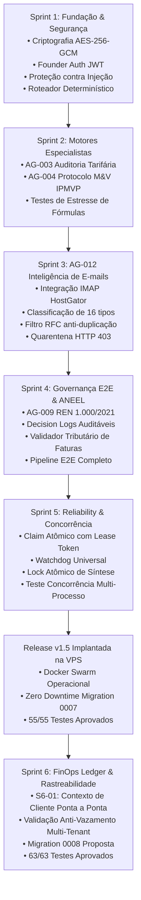

# EI-AIOS — RELATÓRIO CONSOLIDADO DE HANDOVER TÉCNICO & EXECUTIVO
## Energy Intelligence Autonomous Artificial Intelligence Operating System

**Data de Emissão:** 08/11/2026  
**Versão Atual em Produção:** `v1.5-sprint5-complete` (Commit `e25e381` / Tag `v1.5-sprint5-complete`)  
**Branch de Desenvolvimento Ativa:** `feat/sprint-6-finops-ledger` (Commit `60f9440`)  
**Status Global:** 63/63 Testes Automatizados Aprovados (100% PASS, 0 Regressões)

---

## 1. VISÃO GERAL DO PROJETO

O **EI-AIOS** é um Sistema Operacional de Inteligência Artificial Soberano e Multiagente projetado para o mercado B2B de gestão, auditoria, conformidade regulatória e comercialização de energia elétrica no Brasil (mercados cativo e livre).

### 1.1 Premissas Arquiteturais Fundamentais
1. **Governança Estrita & HITL (Human-in-the-Loop):** Ações comerciais de alto impacto (propostas, notificações contratuais, faturamentos) exigem aprovação explícita Nível 2 de um operador humano ou do Founder.
2. **Concorrência Atômica & Idempotência:** Nenhuma tarefa pode ser executada por múltiplos workers simultâneos nem ter seus resultados sobrescritos por processos zumbis ou atrasados (mecanismo de `lease_token`).
3. **Auditoria Regulatória Estrita:** Cálculos de demanda, ultrapassagem, energia reativa (UFER/DMCR) e modalidades tarifárias (Verde vs Azul) seguem estritamente as resoluções da ANEEL (especialmente REN 1.000/2021).
4. **FinOps Baseado em Evidências Reais:** Custos de tokens e modelos LLM (Gemini 3.5 Flash Lite, Gemini 3.8 Flash e Gemini 2.5 Pro) são mensurados e auditados sem números arbitrários ou suposições fictícias.

---

## 2. TOPOLOGIA DOS 12 AGENTES ESPECIALISTAS

| Agente | Código | Nome / Especialidade | Papel e Responsabilidades | Status |
| :--- | :---: | :--- | :--- | :---: |
| **AG-001** | `AG_001` | **Chief Operating Officer (COO)** | Orquestrador Mestre, decomposição de objetivos em tarefas, agregação executiva e síntese de relatórios pós-aprovação. | Operacional |
| **AG-002** | `AG_002` | **Client Onboarding & Integrations** | Gestão de cadastros de clientes, unidades consumidoras (UCs), contratos de fornecimento e conexões com distribuidoras. | Operacional |
| **AG-003** | `AG_003` | **Energy Audit & Tariff Optimizer** | Auditoria minuciosa de faturas do Grupo A/B, detecção de erros de faturamento, cálculo de ultrapassagem de demanda e energia reativa. | Operacional |
| **AG-004** | `AG_004` | **Measurement & Verification (M&V)** | Protocolo IPMVP de economia real comprovada, linha de base energética e cálculo de *success fee* baseado em evidências. | Operacional |
| **AG-005** | `AG_005` | **Solar & DG Asset Manager** | Monitoramento de usinas de Geração Distribuída (GD), rateio de créditos de energia solar e acompanhamento de autoconsumo remoto. | Operacional |
| **AG-006** | `AG_006` | **Free Market Power Trader** | Estratégia de migração para o Mercado Livre de Energia (ACL), modelagem de riscos, BBCE e contratos bilaterais (PPA). | Operacional |
| **AG-007** | `AG_007` | **Contract & Commercial Negotiator** | Minutas contratuais, propostas de valor, prospecção e renegociação comercial com distribuidoras e comercializadoras. | Operacional |
| **AG-008** | `AG_008` | **Quality Assurance & Regulatory Gate** | Gatekeeper independente. Audita todas as entregas dos demais agentes antes de aprovação e bloqueia alucinações técnicas. | Operacional |
| **AG-009** | `AG_009` | **Regulatory Compliance (ANEEL)** | Base de conhecimento e conformidade contínua com resoluções normativas (REN ANEEL 1.000/2021, PRODIST, bandeiras tarifárias). | Operacional |
| **AG-010** | `AG_010` | **Predictive Maintenance & Telemetry** | Análise de telemetria IoT, curvas de carga horárias (memória de massa) e detecção antecipada de anomalias em transformadores/subestações. | Operacional |
| **AG-011** | `AG_011` | **FinOps & Financial Intelligence** | CFO de IA da plataforma. Conciliação real de custos de IA (`agent_runs`), margem de contribuição por cliente, CAC e MRR real. | Em Evolução (S6) |
| **AG-012** | `AG_012` | **Email & Inbound Intelligence** | Conexão IMAP/SMTP (HostGator), extração e classificação de e-mails, imunização contra *Prompt Injection* e triagem autônoma. | Operacional |

---

## 3. HISTÓRICO DE ENTREGAS POR SPRINT



### Detalhamento das Sprints:
- **Sprint 1 (Fundação & Segurança):**
  - Implementação de cofres criptografados (`encryptSecret` / `decryptSecret`) usando AES-256-GCM para credenciais externas.
  - Criação do middleware de autenticação Founder (`founderAuthMiddleware`) com tokens JWT seguros.
  - Implementação do algoritmo de detecção de *Prompt Injection* e *Command Injection* em textos não confiáveis.
  - Roteador determinístico de tarefas para agentes com escalonamento seguro ao AG-001 em caso de exceções.
- **Sprint 2 (Motores de Engenharia & M&V):**
  - Implementação da biblioteca matemática de auditoria tarifária (cálculo de ultrapassagem com tolerância de 5%, fator de carga, energia reativa indutiva/capacitiva, compensação de ICMS/PIS/COFINS).
  - Motor de Medição e Verificação (M&V) aderente ao protocolo internacional IPMVP para cálculo auditável de economia real gerada.
- **Sprint 3 (AG-012 Inteligência de E-mails & Comunicação):**
  - Conexão e sincronização IMAP multi-contas HostGator.
  - Motor de classificação em 16 categorias (faturas A4/B, propostas, avisos de corte, informativos regulatórios, etc.).
  - Preservação de RFC Message-ID, In-Reply-To e References para evitar reprocessamento em threads.
  - Bloqueio rígido de arquivos anexos maliciosos (.exe, .bat, .ps1).
- **Sprint 4 (Auditoria Regulatória & Governança E2E):**
  - Injeção das resoluções vigentes da ANEEL no AG-009 para fundamentação legal de pleitos contra distribuidoras.
  - Estruturação de `decision_logs` para rastreabilidade de todas as escolhas automatizadas dos agentes.
  - Validação de integridade fiscal e tributária de faturas de energia antes de processamento pelos modelos LLM.
- **Sprint 5 (Confiabilidade, Watchdog e Concorrência Real):**
  - Resolução definitiva de condições de corrida via claim atômico com `lease_token`.
  - Invalidação imediata de workers zumbis ou atrasados impedindo sobrescrita de tarefas recuperadas.
  - Lock atômico na transição de tarefas-mãe para o status `synthesizing`, garantindo síntese única pelo AG-001.
  - Watchdog universal com fallback de data para tarefas standalone sem `started_at`.
  - Validação em ambiente multi-processo real com dois workers disputando tarefas concorrentes.
- **Sprint 6 (Em Andamento — FinOps Ledger):**
  - **S6-01 Concluída:** Propagação de contexto operacional e financeiro (`client_id`, `consumer_unit_id`, `execution_id`, `is_internal`) através de todos os 7 pontos de execução da plataforma.
  - Prevenção ativa de contaminação cruzada de custos entre clientes (*cross-tenant leakage*).
  - Compatibilidade com registros históricos legados sem gerar falhas de reconciliação.

---

## 4. ESTADO ATUAL DOS AMBIENTES

### 4.1 Ambiente de Produção (VPS Hostinger / Docker Swarm)
- **Tag da Versão:** `v1.5-sprint5-complete`
- **Commit Publicado:** `e25e3814bcc5dac7c6b779c870673eb0bc1da03f`
- **Containers Ativos (Docker Swarm):**
  - `ei-aios_agent-core`: 1 réplica ativa (API REST, rotinas de background, autenticação).
  - `ei-aios_worker`: 1 réplica ativa (Worker autônomo, processamento de tarefas pendentes e watchdog).
  - `ei-aios_web`: 1 réplica ativa (Interface administrativa e dashboards do operador).
- **Banco de Dados Produção (Supabase PostgreSQL):**
  - Migrations aplicadas: `0001` até `0007`.
  - Tabelas principais: `clients`, `consumer_units`, `tasks`, `agent_runs`, `audit_logs`, `decision_logs`, `energy_bills`.
  - Status dos Leases: Estáveis, sem concorrência espúria ou travamentos de fila.

### 4.2 Ambiente de Desenvolvimento Local
- **Branch Ativa:** `feat/sprint-6-finops-ledger`
- **Commit HEAD:** `60f9440` (Sincronizado com `origin/feat/sprint-6-finops-ledger`)
- **Working Tree:** Totalmente limpa (`working tree clean`).
- **Build Status:** Compilação 100% aprovada dos 3 pacotes (`@ei-aios/shared`, `@ei-aios/agent-core`, `@ei-aios/web`).

---

## 5. EVOLUÇÃO DAS MIGRATIONS DE BANCO DE DADOS

| Migration | Arquivo | Finalidade Principal | Status de Implantação |
| :---: | :--- | :--- | :---: |
| **0001** | `0001_initial_schema.sql` | Criação das tabelas base (`clients`, `tasks`, `agent_runs`, `energy_bills`). | **Produção** |
| **0002** | `0002_rls_and_indexes.sql` | Políticas de segurança RLS e índices de busca. | **Produção** |
| **0003** | `0003_knowledge_sources.sql` | Base de conhecimento e normas ANEEL. | **Produção** |
| **0004** | `0004_finops_tables.sql` | Adição inicial de colunas de custos e métricas financeiras. | **Produção** |
| **0005** | `0005_email_accounts.sql` | Suporte a múltiplas caixas postais HostGator e threads de e-mail. | **Produção** |
| **0006** | `0006_email_raw_messages.sql` | Quarentena, logs brutos e metadados de triagem do AG-012. | **Produção** |
| **0007** | `0007_sprint5_reliability_hardening.sql` | Índices de claim concorrente, lease tokens e status `synthesizing`. | **Produção** |
| **0008** | `0008_sprint6_context_propagation.sql` | Colunas `consumer_unit_id`, `execution_id`, `is_internal` e metadados de execução. | **Proposta (Branch S6)** |

---

## 6. COBERTURA DE TESTES AUTOMATIZADOS (63/63 PASS)

```
✔ Sprint 1 — Fundação, Roteamento & Criptografia (SP1-T01 a SP1-T08) ............ 8/8 PASS
✔ Sprint 2 — Engenharia Tarifária & Protocolo M&V IPMVP ......................... 7/7 PASS
✔ Sprint 3 — AG-012 Inteligência de E-mails & Governança (EMAIL-001 a EMAIL-016) 13/13 PASS
✔ Sprint 4 — Auditoria Regulatória ANEEL & Pipeline E2E (INT-001 a INT-006) ...... 6/6 PASS
✔ Sprint 5 — Reliability, Concorrência Real & Hardening (HARD-01 a HARD-07) ..... 7/7 PASS
✔ Sprint 5 — Teste Concorrente Multi-Processo (EXEC-MULTI-PROC) ................. 1/1 PASS
✔ FinOps — AG-011 CFO Suite (CFO-001 a CFO-010 + Cenários M&V) ................. 13/13 PASS
✔ Sprint 6 — S6-01 Rastreabilidade de Contexto de Cliente (CTX-01 a CTX-08) ..... 8/8 PASS
-----------------------------------------------------------------------------------------
TOTAL GERAL: 63 TESTES EXECUTADOS EM ~15.5s COM ZERO FALHAS E ZERO REGRESSÕES (100% PASS)
```

---

## 7. MATRIZ DE RISCOS & CONTRAMEDIDAS VIGENTES

| Risco Técnico / Operacional | Severidade | Contramedida Implementada no Código |
| :--- | :---: | :--- |
| **Execução duplicada de tarefas** | Crítica | Claim atômico condicional no PostgreSQL (`WHERE status = 'pending'`) com registro de `lease_token` único por worker. |
| **Worker zumbi sobrescrever resultados** | Crítica | O worker revalida se o seu `lease_token` ainda é o proprietário legítimo antes de gravar `completed` ou `failed`. |
| **Múltiplas sínteses do AG-001** | Alta | Transição atômica para status intermediário `synthesizing` antes do disparo da síntese, impedindo síntese concorrente. |
| **Vazamento de custos entre clientes** | Alta | Validador do worker confere se a Unidade Consumidora realmente pertence ao `client_id` da tarefa; bloqueia se houver divergência. |
| **Injeção de instruções em e-mails** | Alta | AG-012 sanitiza e-mails na camada de entrada; instruções maliciosas são enviadas para quarentena com retorno HTTP 403. |
| **Alucinação financeira no FinOps** | Média | AG-011 rejeita geração de números sintéticos; métricas com dados ausentes são retornadas explicitamente com status `incomplete`. |

---

## 8. BACKLOG RESIDUAL DA SPRINT 6

A Sprint 6 tem como foco estruturar o **FinOps Ledger & Real Revenue Engine**:

1. **S6-01 (Concluída):** *Client Context Propagation & Execution Traceability* (Commit `60f9440`).
2. **S6-02 (Próxima):** *Agent Runs Cost Reconciliation & Ledger Engine* — conciliação contábil formal dos custos de tokens com base nos registros propagados de `agent_runs`.
3. **S6-03:** *Real Revenue Pipeline & Contract Billing Sync* — conexão com faturas reais de honorários/mensalidades dos clientes para cálculo real de MRR/ARR sem valores fixos.
4. **S6-04:** *CAC, LTV & Payback Data Foundation* — ingestão das despesas de aquisição e suporte para encerramento do status `incomplete` nessas métricas.
5. **S6-05:** *Observability Ledger Dashboard* — interface visual de conciliação financeira em tempo real para os operadores e Founder.
6. **S6-06:** *E2E Financial Reconciliation Testing* — testes ponta a ponta desde a leitura da fatura até o registro contábil de margem bruta.
7. **S6-07:** *Release v1.6 Preparation & Safe Deployment* — migração 0008 e publicação assistida na VPS.

---

## 9. INVENTÁRIO DE DOCUMENTAÇÃO RELEVANTE

- [`docs/EI_AIOS_S6_01_IMPLEMENTATION_REPORT.md`](file:///c:/_dev/ei-aios/docs/EI_AIOS_S6_01_IMPLEMENTATION_REPORT.md) — Relatório detalhado da atividade S6-01.
- [`docs/EI_AIOS_S6_01_TEST_RESULTS.md`](file:///c:/_dev/ei-aios/docs/EI_AIOS_S6_01_TEST_RESULTS.md) — Evidências de execução dos cenários CTX-01 a CTX-08.
- [`docs/EI_AIOS_IMPLEMENTATION_BACKLOG.md`](file:///c:/_dev/ei-aios/docs/EI_AIOS_IMPLEMENTATION_BACKLOG.md) — Backlog de engenharia de todas as sprints.
- [`docs/EI_AIOS_POST_RELEASE_V1_5_AUDIT_REPORT.md`](file:///c:/_dev/ei-aios/docs/EI_AIOS_POST_RELEASE_V1_5_AUDIT_REPORT.md) — Auditoria pós-deploy da Release v1.5.
- [`docs/EI_AIOS_TEST_RESULTS.md`](file:///c:/_dev/ei-aios/docs/EI_AIOS_TEST_RESULTS.md) — Histórico consolidado de suítes de testes.
- [`supabase/migrations/0008_sprint6_context_propagation.sql`](file:///c:/_dev/ei-aios/supabase/migrations/0008_sprint6_context_propagation.sql) — DDL da Migration 0008.
