# EI-AIOS — RELATÓRIO CONSOLIDADO DE HANDOVER TÉCNICO & EXECUTIVO
## Energy Intelligence Autonomous Artificial Intelligence Operating System

**Data de Emissão:** 08/11/2026  
**Versão Atual em Produção:** `v1.5-sprint5-complete` (Commit `e25e381` / Tag `v1.5-sprint5-complete`)  
**Branch de Desenvolvimento Ativa:** `feat/sprint-6-finops-ledger`  
**HEAD Commit Atual da Branch:** `3f26fff` (`feat(sprint-6): S6-05 observability ledger dashboard e agregadores finops`)  
**Status Global:** 117/117 Testes Automatizados Aprovados (100% PASS, 0 Falhas, 0 Regressões)  
**Ambiente de Produção (VPS Hostinger / Docker Swarm):** Totalmente Bloqueado / Preservado (Zero deploy e zero restarts não autorizados)

---

## 1. VISÃO GERAL DO PROJETO & STATUS ATUAL

O **EI-AIOS** é um Sistema Operacional de Inteligência Artificial Soberano e Multiagente projetado para o mercado B2B de gestão, auditoria, conformidade regulatória e comercialização de energia elétrica no Brasil (mercados cativo e livre).

O projeto atingiu a maturidade da **Sprint 6 (FinOps Ledger & Sovereign Financial Architecture)**, com 5 das 7 atividades previstas concluídas e auditadas com excelência contábil e técnica:
- **S6-01 Concluída:** Propagação de contexto operacional e rastreabilidade ponta a ponta.
- **S6-02 Concluída:** Cost & Usage Ledger Engine determinístico de `agent_runs`.
- **S6-03 Concluída:** Real Revenue Pipeline segregando receita contratada, faturada, recebida e Success Fee auditado por M&V.
- **S6-04 Concluída:** CAC, LTV & Payback Data Foundation com governança e auditoria contábil.
- **S6-05 Concluída:** Observability Ledger Dashboard, agregadores executivos e eliminação definitiva de valores fictícios (como o default estático de R$ 1.490).

---

## 2. TOPOLOGIA DOS 12 AGENTES ESPECIALISTAS

| Agente | Código | Especialidade | Papel e Responsabilidades | Status |
| :--- | :---: | :--- | :--- | :---: |
| **AG-001** | `AG_001` | **Chief Operating Officer (COO)** | Orquestrador Mestre, decomposição de objetivos em tarefas, agregação executiva e síntese de relatórios pós-aprovação. | Operacional |
| **AG-002** | `AG_002` | **Client Onboarding & Integrations** | Gestão de cadastros de clientes, unidades consumidoras (UCs), contratos de fornecimento e conexões com distribuidoras. | Operacional |
| **AG-003** | `AG_003` | **Energy Audit & Tariff Optimizer** | Auditoria minuciosa de faturas do Grupo A/B, detecção de erros de faturamento, cálculo de ultrapassagem de demanda e energia reativa. | Operacional |
| **AG-004** | `AG_004` | **Measurement & Verification (M&V)** | Protocolo IPMVP de economia real comprovada, linha de base energética e cálculo de *success fee* auditável. | Operacional |
| **AG-005** | `AG_005` | **Solar & DG Asset Manager** | Monitoramento de usinas de Geração Distribuída (GD), rateio de créditos de energia solar e acompanhamento de autoconsumo remoto. | Operacional |
| **AG-006** | `AG_006` | **Free Market Power Trader** | Estratégia de migração para o Mercado Livre de Energia (ACL), modelagem de riscos, BBCE e contratos bilaterais (PPA). | Operacional |
| **AG-007** | `AG_007` | **Contract & Commercial Negotiator** | Minutas contratuais, propostas de valor, prospecção e renegociação comercial com distribuidoras e comercializadoras. | Operacional |
| **AG-008** | `AG_008` | **Quality Assurance & Regulatory Gate** | Gatekeeper independente. Audita todas as entregas dos demais agentes antes de aprovação e bloqueia alucinações técnicas. | Operacional |
| **AG-009** | `AG_009` | **Regulatory Compliance (ANEEL)** | Base de conhecimento e conformidade contínua com resoluções normativas (REN ANEEL 1.000/2021, PRODIST, bandeiras tarifárias). | Operacional |
| **AG-010** | `AG_010` | **Predictive Maintenance & Telemetry** | Análise de telemetria IoT, curvas de carga horárias (memória de massa) e detecção antecipada de anomalias em transformadores/subestações. | Operacional |
| **AG-011** | `AG_011` | **FinOps & Financial Intelligence** | CFO de IA da plataforma. Conciliação real de custos de IA (`agent_runs`), margem de contribuição por cliente, CAC, LTV e MRR real. | **Soberano & Auditado (S6)** |
| **AG-012** | `AG_012` | **Email & Inbound Intelligence** | Conexão IMAP/SMTP (HostGator), extração e classificação de e-mails, imunização contra *Prompt Injection* e triagem autônoma. | Operacional |

---

## 3. HISTÓRICO CONSOLIDADO DE SPRINTS

```mermaid
flowchart TD
    S1["Sprint 1: Fundação & Segurança<br/>• Criptografia AES-256-GCM<br/>• Founder Auth JWT<br/>• Proteção contra Injeção<br/>• Roteador Determinístico"] --> S2["Sprint 2: Motores Especialistas<br/>• AG-003 Auditoria Tarifária<br/>• AG-004 Protocolo M&V IPMVP<br/>• Testes de Estresse de Fórmulas"]
    S2 --> S3["Sprint 3: AG-012 Inteligência de E-mails<br/>• Integração IMAP HostGator<br/>• Classificação de 16 tipos<br/>• Filtro RFC anti-duplicação<br/>• Quarentena HTTP 403"]
    S3 --> S4["Sprint 4: Governança E2E & ANEEL<br/>• AG-009 REN 1.000/2021<br/>• Decision Logs Auditáveis<br/>• Validador Tributário de Faturas<br/>• Pipeline E2E Completo"]
    S4 --> S5["Sprint 5: Reliability & Concorrência<br/>• Claim Atômico com Lease Token<br/>• Watchdog Universal<br/>• Lock Atômico de Síntese<br/>• Teste Concorrência Multi-Processo"]
    S5 --> REL["Release v1.5 Implantada em Produção<br/>• Docker Swarm Operacional<br/>• Migrations 0001 a 0007 Aplicadas<br/>• 63/63 Testes Globais"]
    REL --> S6["Sprint 6: FinOps Ledger & Sovereign Financials<br/>• S6-01: Contexto de Cliente Ponta a Ponta (Commit 60f9440)<br/>• S6-02: Cost Ledger de agent_runs (Commit 74903bc)<br/>• S6-03: Real Revenue Pipeline & Success Fee (Commit ac646da)<br/>• S6-04: CAC, LTV & Payback Data Foundation (Commit 0cda273)<br/>• S6-05: Observability Ledger Dashboard (Commit 3f26fff)<br/>• 117/117 Testes Globais Aprovados (100% PASS)"]
```



---

## 4. ENTREGAS DA SPRINT 6 ATÉ O MOMENTO (S6-01 A S6-05)

### 4.1 S6-01 — Context Propagation & Multi-Tenant Traceability
- Propagação estrita dos campos `client_id`, `consumer_unit_id`, `execution_id`, `task_id` e `is_internal` através de todos os 7 pontos de execução do sistema (`task-router`, `worker`, `gemini-service`, `autonomous-execution-engine`, etc.).
- Validação multi-tenant em tempo de execução: bloqueio de execução quando uma Unidade Consumidora não pertencer ao cliente informado.
- Migration Proposta: `0008_sprint6_context_propagation.sql`.

### 4.2 S6-02 — Agent Runs Cost Reconciliation & Ledger Engine
- Motor determinístico de reconciliação contábil (`FinopsLedgerEngine`) para a tabela `agent_runs`.
- Tabela oficial de precificação por milhão de tokens (Gemini 3.5 Flash Lite, Gemini 3.8 Flash, Gemini 2.5 Pro).
- Segregação rigorosa em 3 categorias contábeis:
  * `client_attributable`: Custo diretamente associado a um cliente.
  * `platform_internal`: Custos de rotinas internas e orquestração.
  * `unattributed_legacy` / `unattributed_orphan`: Custos legados ou sem contexto.
- Tiers formais de confiabilidade: `measured`, `estimated`, `incomplete`.
- Migration Proposta: `0009_sprint6_finops_ledger.sql`.

### 4.3 S6-03 — Real Revenue Pipeline & Contract Billing Sync
- Motor determinístico de receita (`RevenuePipelineEngine`) segregando estritamente:
  * **Contracted Revenue:** Receita contratual recorrente formalizada.
  * **Invoiced Revenue:** Faturas emitidas com vencimento e competência.
  * **Received Revenue:** Liquidações financeiras efetivas comprovadas por transação.
  * **Success Fee Engine:** Cálculo auditável de taxa de sucesso baseado exclusivamente em economia real comprovada pelo AG-004 (IPMVP), com trava de aprovação humana (HITL).
- Cálculo determinístico de Margem de Contribuição por cliente sobre faturamento e sobre recebimentos reais.
- Migration Proposta: `0010_sprint6_real_revenue_pipeline.sql`.

### 4.4 S6-04 — CAC, LTV & Payback Data Foundation
- Motor de Unit Economics (`UnitEconomicsEngine`) fundamentado em dados auditáveis:
  * Ingestão e validação contábil de despesas de aquisição (S&M).
  * Registro de custos diretos operacionais e de suporte por cliente (COGS).
  * Cálculo determinístico de CAC em janelas móveis de 30, 60 e 90 dias com prevenção de divisão por zero.
  * Cálculo de LTV baseado na margem de contribuição mensal média real (sem projeções fictícias).
  * Cálculo de Payback do investimento de aquisição em meses.
  * Tratamento estrito de incompletude: ausência de dados retorna explicitamente `status: incomplete` e valor `null`.
- Migration Proposta: `0011_sprint6_unit_economics.sql`.

### 4.5 S6-05 — Observability Ledger Dashboard & Agregadores FinOps
- Agregador backend executivo e operacional (`ObservabilityDashboardService`).
- Novos endpoints REST: `/api/v1/finops/dashboard/overview` e `/api/v1/finops/dashboard/cost-usage`.
- **Eliminação completa do valor fictício de R$ 1.490 e R$ 17.880** do backend e do frontend.
- Interface web reestruturada em `packages/web-ui/src/app/finops/page.tsx` com seletor de competência, badges visuais de confiabilidade (`AUDITADO`, `ESTIMADO`, `INCOMPLETO`), detalhamento de Unit Economics e painel com consumo por agente, modelo e segregação de custos.

---

## 5. EVOLUÇÃO DAS MIGRATIONS DE BANCO DE DADOS

| Migration | Arquivo | Finalidade Principal | Status de Implantação |
| :---: | :--- | :--- | :---: |
| **0001** | `0001_initial_schema.sql` | Tabelas base (`clients`, `tasks`, `agent_runs`, `energy_bills`). | **Produção (Aplicada)** |
| **0002** | `0002_rls_and_indexes.sql` | Políticas RLS e índices de busca. | **Produção (Aplicada)** |
| **0003** | `0003_knowledge_sources.sql` | Normas regulatórias e resoluções ANEEL. | **Produção (Aplicada)** |
| **0004** | `0004_finops_tables.sql` | Colunas de custos e métricas financeiras. | **Produção (Aplicada)** |
| **0005** | `0005_email_accounts.sql` | Caixas postais HostGator e threads de e-mail. | **Produção (Aplicada)** |
| **0006** | `0006_email_raw_messages.sql` | Quarentena, logs brutos e triagem AG-012. | **Produção (Aplicada)** |
| **0007** | `0007_sprint5_reliability_hardening.sql` | Claim atômico com lease tokens e lock `synthesizing`. | **Produção (Aplicada)** |
| **0008** | `0008_sprint6_context_propagation.sql` | Colunas `consumer_unit_id`, `execution_id`, `is_internal`. | **Proposta (Branch S6)** |
| **0009** | `0009_sprint6_finops_ledger.sql` | Tabela `finops_ledger_entries` e precificação de tokens. | **Proposta (Branch S6)** |
| **0010** | `0010_sprint6_real_revenue_pipeline.sql` | Tabelas `client_contracts`, `invoices`, `payments`, `success_fee_events`. | **Proposta (Branch S6)** |
| **0011** | `0011_sprint6_unit_economics.sql` | Tabelas `acquisition_expenses`, `operational_expenses`, `customer_acquisitions`. | **Proposta (Branch S6)** |

> **Nota de Segurança:** As migrations 0008 a 0011 estão validadas e prontas na branch de desenvolvimento, mas **NÃO foram aplicadas no banco de produção**, respeitando a política de congelamento até a Release v1.6 (S6-07).

---

## 6. COBERTURA GLOBAL DE TESTES AUTOMATIZADOS (117/117 PASS)

```
✔ Sprint 1 — Fundação, Roteamento & Criptografia (SP1-T01 a SP1-T08) ............ 8/8 PASS
✔ Sprint 2 — Engenharia Tarifária & Protocolo M&V IPMVP ......................... 7/7 PASS
✔ Sprint 3 — AG-012 Inteligência de E-mails & Governança (EMAIL-001 a EMAIL-016) 13/13 PASS
✔ Sprint 4 — Auditoria Regulatória ANEEL & Pipeline E2E (INT-001 a INT-006) ...... 6/6 PASS
✔ Sprint 5 — Reliability, Concorrência Real & Hardening (HARD-01 a HARD-07) ..... 7/7 PASS
✔ Sprint 5 — Teste Concorrente Multi-Processo (EXEC-MULTI-PROC) ................. 1/1 PASS
✔ FinOps — AG-011 CFO Suite (CFO-001 a CFO-010 + Cenários M&V) ................. 13/13 PASS
✔ Sprint 6 — S6-01 Rastreabilidade de Contexto de Cliente (CTX-01 a CTX-08) ..... 8/8 PASS
✔ Sprint 6 — S6-01 Anti-Vazamento e Validação Cross-Tenant (CTX-09 a CTX-12) .... 4/4 PASS
✔ Sprint 6 — S6-02 FinOps Ledger Engine (LEDGER-01 a LEDGER-12) ................ 12/12 PASS
✔ Sprint 6 — S6-03 Real Revenue Pipeline & Success Fee (REV-01 a REV-18) ........ 18/18 PASS
✔ Sprint 6 — S6-04 CAC, LTV & Payback Data Foundation (UE-01 a UE-06) ........... 6/6 PASS
✔ Sprint 6 — S6-05 Observability Ledger Dashboard (DASH-01 a DASH-06) ........... 6/6 PASS
-----------------------------------------------------------------------------------------
TOTAL GERAL: 117 TESTES EXECUTADOS COM ZERO FALHAS E ZERO REGRESSÕES (100% PASS)
```

---

## 7. ESTADO ATUAL DOS AMBIENTES

### 7.1 Produção (VPS Hostinger / Docker Swarm)
- **Tag:** `v1.5-sprint5-complete`
- **Commit:** `e25e3814bcc5dac7c6b779c870673eb0bc1da03f`
- **Serviços Ativos:**
  - `ei-aios_agent-core`: 1 réplica ativa (API REST, autenticação, rotinas).
  - `ei-aios_worker`: 1 réplica ativa (Worker autônomo e watchdog com claim atômico).
  - `ei-aios_web`: 1 réplica ativa (Interface web de produção).
- **Banco Supabase:** Migrations 0001 até 0007 aplicadas e estáveis.

### 7.2 Desenvolvimento Local
- **Branch:** `feat/sprint-6-finops-ledger`
- **HEAD Commit:** `3f26fff` (Totalmente sincronizado com `origin/feat/sprint-6-finops-ledger`)
- **Working Tree:** Totalmente limpa (`working tree clean`).
- **Build Status:** Compilação 100% limpa dos 3 pacotes (`@ei-aios/shared`, `@ei-aios/agent-core`, `@ei-aios/web-ui`).

---

## 8. MATRIZ DE RISCOS & CONTRAMEDIDAS VIGENTES

| Risco Técnico / Operacional | Severidade | Contramedida Implementada no Código |
| :--- | :---: | :--- |
| **Execução duplicada de tarefas** | Crítica | Claim atômico condicional no PostgreSQL (`WHERE status = 'pending'`) com `lease_token` exclusivo. |
| **Worker zumbi sobrescrever resultados** | Crítica | Validação estrita do `lease_token` antes de registrar transições para `completed` ou `failed`. |
| **Múltiplas sínteses concorrentes** | Alta | Transição atômica para status `synthesizing` antes do disparo da consolidação do AG-001. |
| **Vazamento de custos entre clientes** | Alta | Validador do worker confere correspondência estrita entre `consumer_unit_id` e `client_id` (S6-01). |
| **Injeção de instruções maliciosas** | Alta | AG-012 sanitiza e-mails na entrada com isolamento em quarentena (HTTP 403). |
| **Alucinação / Dados Fictícios de Receita** | Alta | AG-011 eliminou valores de fallback estáticos (R$ 1.490); dados incompletos retornam `incomplete` / `null` (S6-03, S6-04, S6-05). |
| **Success Fee sem comprovação** | Alta | Trava determinística: cobrança de Success Fee só é elegível se validada formalmente pelo protocolo IPMVP do AG-004 com aprovação humana (HITL). |
| **Contaminação multi-tenant de Unit Economics** | Alta | Segregação estrita por `tenantId` em despesas de marketing, novos clientes, CAC e LTV (S6-04, S6-05). |

---

## 9. PRÓXIMOS PASSOS (BACKLOG RESTANTE DA SPRINT 6)

A Sprint 6 encontra-se na reta final, restando duas atividades estruturadas:

1. **S6-06: E2E Financial Reconciliation Testing & Handover**
   - Criação de suíte de testes de integração ponta a ponta validando o ciclo financeiro completo:
     * Ingestão de faturas e chamadas de modelos LLM.
     * Reconciliação no ledger contábil de IA.
     * Faturamento de MRR e Success Fee aprovado por M&V.
     * Liquidação de recebíveis e cálculo de margem real.
     * Apuração de CAC e Payback no dashboard executivo.
2. **S6-07: Release v1.6 Preparation & Safe Deployment**
   - Script consolidado e idempotente das migrations 0008, 0009, 0010 e 0011.
   - Tag oficial `v1.6-sprint6-complete`.
   - Procedimento de deploy assistido com zero downtime no Docker Swarm da VPS Hostinger.
   - Validação de sanidade pós-deploy (*smoke tests* em produção).

---

## 10. INVENTÁRIO COMPLETO DE ARQUIVOS E DOCUMENTAÇÃO

### Relatórios de Engenharia da Sprint 6
- [`docs/EI_AIOS_S6_01_IMPLEMENTATION_REPORT.md`](file:///c:/_dev/ei-aios/docs/EI_AIOS_S6_01_IMPLEMENTATION_REPORT.md) — Relatório de implementação da S6-01.
- [`docs/EI_AIOS_S6_01_TEST_RESULTS.md`](file:///c:/_dev/ei-aios/docs/EI_AIOS_S6_01_TEST_RESULTS.md) — Evidências de testes da S6-01 (CTX-01 a CTX-12).
- [`docs/EI_AIOS_S6_02_IMPLEMENTATION_REPORT.md`](file:///c:/_dev/ei-aios/docs/EI_AIOS_S6_02_IMPLEMENTATION_REPORT.md) — Relatório de implementação da S6-02.
- [`docs/EI_AIOS_S6_02_TEST_RESULTS.md`](file:///c:/_dev/ei-aios/docs/EI_AIOS_S6_02_TEST_RESULTS.md) — Evidências de testes da S6-02 (LEDGER-01 a LEDGER-12).
- [`docs/EI_AIOS_S6_03_IMPLEMENTATION_REPORT.md`](file:///c:/_dev/ei-aios/docs/EI_AIOS_S6_03_IMPLEMENTATION_REPORT.md) — Relatório de implementação da S6-03.
- [`docs/EI_AIOS_S6_03_TEST_RESULTS.md`](file:///c:/_dev/ei-aios/docs/EI_AIOS_S6_03_TEST_RESULTS.md) — Evidências de testes da S6-03 (REV-01 a REV-18).
- [`docs/EI_AIOS_S6_04_IMPLEMENTATION_REPORT.md`](file:///c:/_dev/ei-aios/docs/EI_AIOS_S6_04_IMPLEMENTATION_REPORT.md) — Relatório de implementação da S6-04.
- [`docs/EI_AIOS_S6_04_TEST_RESULTS.md`](file:///c:/_dev/ei-aios/docs/EI_AIOS_S6_04_TEST_RESULTS.md) — Evidências de testes da S6-04 (UE-01 a UE-06).
- [`docs/EI_AIOS_S6_05_IMPLEMENTATION_REPORT.md`](file:///c:/_dev/ei-aios/docs/EI_AIOS_S6_05_IMPLEMENTATION_REPORT.md) — Relatório de implementação da S6-05.
- [`docs/EI_AIOS_S6_05_TEST_RESULTS.md`](file:///c:/_dev/ei-aios/docs/EI_AIOS_S6_05_TEST_RESULTS.md) — Evidências de testes da S6-05 (DASH-01 a DASH-06).

### Motores Centrais Implementados na Sprint 6
- [`packages/agent-core/src/tools/finops-ledger-engine.ts`](file:///c:/_dev/ei-aios/packages/agent-core/src/tools/finops-ledger-engine.ts) — Motor de conciliação de custos de IA da S6-02.
- [`packages/agent-core/src/tools/revenue-pipeline-engine.ts`](file:///c:/_dev/ei-aios/packages/agent-core/src/tools/revenue-pipeline-engine.ts) — Pipeline de receitas reais e Success Fee da S6-03.
- [`packages/agent-core/src/tools/unit-economics-engine.ts`](file:///c:/_dev/ei-aios/packages/agent-core/src/tools/unit-economics-engine.ts) — Motor contábil de CAC, LTV e Payback da S6-04.
- [`packages/agent-core/src/tools/observability-dashboard-service.ts`](file:///c:/_dev/ei-aios/packages/agent-core/src/tools/observability-dashboard-service.ts) — Agregador executivo e operacional da S6-05.
- [`packages/web-ui/src/app/finops/page.tsx`](file:///c:/_dev/ei-aios/packages/web-ui/src/app/finops/page.tsx) — Dashboard de FinOps & Unit Economics da S6-05.

### Migrations DDL Propostas da Sprint 6
- [`supabase/migrations/0008_sprint6_context_propagation.sql`](file:///c:/_dev/ei-aios/supabase/migrations/0008_sprint6_context_propagation.sql)
- [`supabase/migrations/0009_sprint6_finops_ledger.sql`](file:///c:/_dev/ei-aios/supabase/migrations/0009_sprint6_finops_ledger.sql)
- [`supabase/migrations/0010_sprint6_real_revenue_pipeline.sql`](file:///c:/_dev/ei-aios/supabase/migrations/0010_sprint6_real_revenue_pipeline.sql)
- [`supabase/migrations/0011_sprint6_unit_economics.sql`](file:///c:/_dev/ei-aios/supabase/migrations/0011_sprint6_unit_economics.sql)
