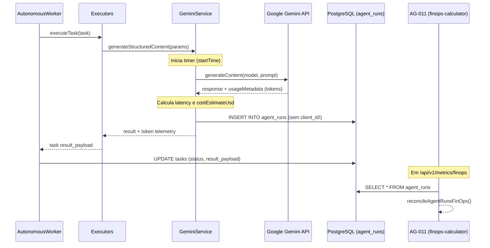

# EI-AIOS — AUDITORIA DE OBSERVABILIDADE (ESTADO ATUAL AS-IS)
## Mapeamento da Telemetria Operacional, Rastreabilidade de Execução e Lacunas

**Data:** 08/11/2026  
**Ambiente:** Release `v1.5-sprint5-complete`  
**Escopo:** Telemetria de Agentes, Workers, APIs, LLMs e Banco de Dados

---

## 1. Matriz de Cobertura de Telemetria (Campos Obrigatórios de Observabilidade)

A tabela abaixo compara os requisitos essenciais de observabilidade de um Sistema Operacional Multiagente Soberano contra a implementação real encontrada em `packages/agent-core`:

| Requisito de Observabilidade | Implementado? | Onde é Capturado? | Formato / Tipo | Lacuna / Comportamento Atual |
|---|:---:|---|---|---|
| **1. Identificação da Execução** | **SIM** | `agent_runs.id` | UUID v4 | Chave primária gerada no banco; único por invocação de LLM. |
| **2. Agente Responsável** | **SIM** | `agent_runs.agent_id` | `VARCHAR(20)` | Ex: `'AG-001'`, `'AG-003'`, etc. Identifica o agente chamador. |
| **3. Modelo de IA Utilizado** | **SIM** | `agent_runs.model_name` | `VARCHAR(50)` | Ex: `'gemini-3.5-flash-lite'`, `'gemini-2.5-pro'`. |
| **4. Provedor de IA** | **SIM** | `agent_runs.model_provider` | `VARCHAR(50)` | Fixo em `'google'`. Não suporta multi-provider hoje. |
| **5. Tokens de Entrada (Input)** | **SIM** | `agent_runs.input_tokens` | `INTEGER` | Capturado de `response.usageMetadata.promptTokenCount`. |
| **6. Tokens de Saída (Output)** | **SIM** | `agent_runs.output_tokens` | `INTEGER` | Capturado de `response.usageMetadata.candidatesTokenCount`. |
| **7. Duração da Execução** | **SIM** | `agent_runs.execution_time_ms`| `INTEGER` | `Date.now() - startTime` cobrindo o roundtrip à API Gemini. |
| **8. Resultado da Execução** | **SIM** | `agent_runs.status` | `VARCHAR(20)` | `'success'` ou `'error'`. |
| **9. Custo Calculado da Chamada** | **SIM** | `agent_runs.cost_estimate` | `NUMERIC(10, 6)` | Custo estimado em dólares via fórmula determinística. |
| **10. Cliente Associado (`client_id`)** | **PARCIAL** | `agent_runs.client_id` | UUID | Coluna existe no schema DDL, **mas é gravada sempre como NULL** pelo `gemini.ts`. |
| **11. Unidade Consumidora (`consumer_unit_id`)** | **NÃO** | Inexistente | N/A | Não há coluna nem propagação de UC na telemetria de runs. |
| **12. Tarefa Vinculada (`task_id`)** | **PARCIAL** | `agent_runs.task_id` | UUID | Gravado em execuções de tarefas, mas `NULL` em conversas de chat direto. |
| **13. Mensagens de Erro** | **SIM** | `agent_runs.error_message` | `TEXT` | Preenchido quando ocorre falha na chamada. |
| **14. Tentativas e Retries** | **PARCIAL** | `tasks.retry_count` | `INTEGER` | O retry é rastreado na tarefa, mas não correlaciona quais `agent_runs` pertenceram a qual tentativa. |
| **15. Uso de Ferramentas / Tools** | **NÃO** | Inexistente | N/A | Ferramentas determinísticas (`energy-calculator`, `finops-calculator`) não emitem telemetria individual de tempo ou custo. |
| **16. Chamadas a APIs Externas** | **NÃO** | Inexistente | N/A | Conexões IMAP/SMTP, uploads para bucket S3/Supabase Storage não geram registros de observabilidade. |

---

## 2. Fluxo e Ciclo de Vida da Telemetria Atual

---

## 3. Análise da Persistência e Consulta Histórica

1. **Camada de Persistência:**
   - Armazenamento em tabela transacional única (`agent_runs`) no PostgreSQL 16.
   - Chave estrangeira `task_id REFERENCES tasks(id) ON DELETE SET NULL`.
   - Chave estrangeira `client_id REFERENCES clients(id) ON DELETE SET NULL`.
   - Índices existentes: `idx_agent_runs_client_id` e índice de chave primária `id`.
2. **Capacidade de Consulta Histórica:**
   - As consultas são realizadas via PostgREST ou `supabase.from('agent_runs').select('*')`.
   - O volume atual em produção é de 33 registros.
   - **Gargalo Identificado:** O endpoint `/api/v1/metrics/finops` faz um `SELECT *` irrestrito na tabela `agent_runs` (`routes.ts:364`). Quando o volume atingir dezenas de milhares de execuções, haverá degradação de memória e latência no Agent Core. Faltam agregações via `GROUP BY` no próprio banco e janelamento temporal obrigatório (`created_at >= NOW() - INTERVAL '30 days'`).
3. **Logs de Aplicação (stdout/stderr):**
   - Logs do Node.js formatados via `console.log` e `console.warn` estruturados com prefixos (`[AutonomousWorker]`, `[GeminiService]`, `[EmailIntelligence]`).
   - Coletados pelo Docker daemon na VPS (`docker service logs ei-aios_agent-core`).
   - Sem exportador OpenTelemetry, Prometheus ou Loki configurado atualmente.

---

## 4. Diagnóstico de Lacunas Críticas (AS-IS Gaps)

1. **Gap OBS-01 — Ausência de Propagação de `client_id` e `consumer_unit_id`:**
   - O orquestrador sabe para qual cliente uma tarefa está sendo executada, mas essa informação morre no `executors.ts` e não desce para o `GeminiService`.
2. **Gap OBS-02 — Custos de IA Baseados em Tabela Estática de Preços:**
   - Se o Google atualizar os preços da família Gemini 3, é necessário alterar o código TypeScript em `PRICING_PER_MILLION` e recompilar o container.
3. **Gap OBS-03 — Falta de Telemetria de Ferramentas Determinísticas e APIs Externas:**
   - Não se sabe quanto tempo o OCR multimodal ou a leitura de 100 e-mails via IMAP demorou para rodar.
4. **Gap OBS-04 — Inexistência de Ledger Financeiro Consolidado:**
   - Gastos com servidores, bancos de dados, armazenamento de faturas e licenças de software não estão integrados à inteligência financeira da empresa.
