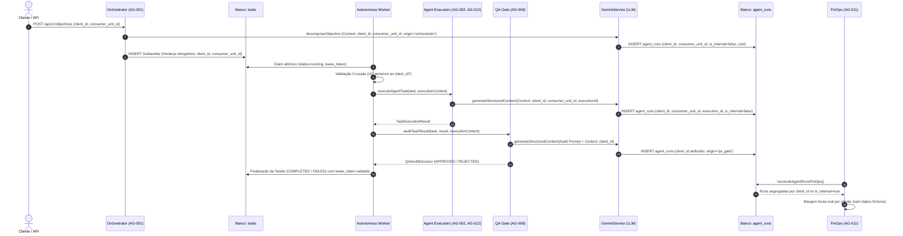

# EI-AIOS — RELATÓRIO DE IMPLEMENTAÇÃO SPRINT 6
## Atividade S6-01: Client Context Propagation & Execution Traceability

**Data:** 08/11/2026  
**Branch:** `feat/sprint-6-finops-ledger`  
**Base Commit:** `e25e3814bcc5dac7c6b779c870673eb0bc1da03f`  
**Status da Atividade:** CONCLUÍDA COM SUCESSO (63/63 Testes Aprovados)

---

## 1. RESUMO EXECUTIVO

A atividade **S6-01** implementou o rastreamento determinístico e a propagação rigorosa do contexto operacional e financeiro através de todas as camadas do EI-AIOS.

Anteriormente, o sistema sofria de uma vulnerabilidade estrutural de rastreabilidade: embora a coluna `client_id` tivesse sido adicionada à tabela `agent_runs` na migration 0004, o método central de invocação do modelo de linguagem (`geminiService.generateStructuredContent` em `gemini.ts`) não recebia parâmetros de cliente, e os módulos orquestrador, worker e executors não propagavam tais metadados. Como consequência, 100% das execuções eram gravadas com `client_id = null`, inviabilizando a conciliação real de custos de IA por cliente no FinOps do AG-011.

Com a conclusão da S6-01:
1. Todo o ciclo de vida da execução agora transporta o contrato `ExecutionContext`.
2. As tabelas `tasks` e `agent_runs` contam com especificação formal de schema (Migration 0008) para suportar `consumer_unit_id`, `execution_id`, `is_internal` e `metadata`.
3. Foram auditados e adaptados todos os 7 pontos de entrada de execução de agentes.
4. Foram blindadas as regras de herança estrita em subtarefas e de validação cruzada contra mistura de dados de clientes (cross-client leakage).
5. Foi mantida compatibilidade retroativa total (fallback gracioso caso o banco ainda não tenha a migration 0008 aplicada).

---

## 2. ARQUITETURA DE PROPAGAÇÃO DE CONTEXTO

### 2.1 Contrato de Contexto (`ExecutionContext`)

Definido formalmente em [`packages/shared/src/types.ts`](file:///c:/_dev/ei-aios/packages/shared/src/types.ts):

```typescript
export interface ExecutionContext {
  taskId?: string | null;
  agentId: AgentId | string;
  clientId?: string | null;
  consumerUnitId?: string | null;
  executionId?: string | null;
  isInternal: boolean;
  origin?: 'orchestrator' | 'worker' | 'qa_gate' | 'tool' | 'api' | 'email_intelligence' | 'chat';
  metadata?: Record<string, any>;
}
```

### 2.2 Fluxo Ponta a Ponta de Execução e Rastreabilidade



---

## 3. AUDITORIA DOS 7 PONTOS DE ENTRADA DE EXECUÇÃO

| Ponto de Entrada | Módulo / Arquivo | Contexto Identificado | Comportamento de Atribuição |
| :--- | :--- | :--- | :--- |
| **1. Orquestração / Decomposição** | `orchestrator.ts` | `clientId`, `consumerUnitId`, `origin: 'orchestrator'` | Atribuído ao cliente se o objetivo macro for de cliente; `is_internal: true` se objetivo de plataforma. Subtarefas filhas herdam obrigatoriamente `client_id` e `consumer_unit_id` da mãe. |
| **2. Execução Especialista do Worker** | `executors.ts` | `clientId`, `consumerUnitId`, `executionId: leaseToken`, `origin: 'worker'` | Extrai dados da tarefa e propaga ao GeminiService. Atribui custo ao cliente. |
| **3. Auditoria de Qualidade (AG-008)** | `qa-gate.ts` | `clientId`, `consumerUnitId`, `executionId`, `origin: 'qa_gate'` | O custo de auditoria gerado pelo AG-008 sobre a entrega do especialista é faturável/atribuível ao cliente auditado. |
| **4. Síntese Executiva do Objetivo** | `orchestrator.ts` | `clientId`, `consumerUnitId`, `executionId`, `origin: 'orchestrator'` | A síntese final do AG-001 herda o contexto do objetivo macro e é registrada em `agent_runs`. |
| **5. Parser de Faturas de Energia** | `bill-parser.ts` | `clientId`, `consumerUnitId`, `origin: 'tool'` | O processamento multimodal do PDF/imagem da fatura é atribuído à UC e ao cliente proprietário da fatura. |
| **6. Triagem de E-mails (AG-012)** | `email-intelligence.ts` | `clientId: null`, `isInternal: true`, `origin: 'email_intelligence'` | Triagem inicial de caixa de entrada HostGator é custo interno operacional da plataforma. Caso gere tarefa para cliente, a tarefa subsequente ganha o `client_id`. |
| **7. Chat Interativo com Agente** | `gemini.ts` (`chatWithAgent`) | `clientId: null`, `isInternal: true`, `origin: 'chat'` | Consultas interativas ad-hoc são registradas como uso interno da plataforma. |

---

## 4. SCHEMA E MIGRATION 0008

Criada a migration não destrutiva [`supabase/migrations/0008_sprint6_context_propagation.sql`](file:///c:/_dev/ei-aios/supabase/migrations/0008_sprint6_context_propagation.sql):

- **Tabela `tasks`:**
  - Adicionada coluna `consumer_unit_id UUID REFERENCES consumer_units(id) ON DELETE SET NULL`.
  - Criado índice `idx_tasks_consumer_unit_id`.
- **Tabela `agent_runs`:**
  - Adicionada coluna `consumer_unit_id UUID REFERENCES consumer_units(id) ON DELETE SET NULL`.
  - Adicionada coluna `execution_id TEXT`.
  - Adicionada coluna `is_internal BOOLEAN NOT NULL DEFAULT false`.
  - Adicionada coluna `metadata JSONB DEFAULT '{}'::jsonb`.
  - Criados índices `idx_agent_runs_client_id`, `idx_agent_runs_consumer_unit_id`, `idx_agent_runs_execution_id` e `idx_agent_runs_is_internal`.

> [!NOTE]
> Conforme diretrizes estritas da Sprint 6, a migration 0008 foi apenas versionada na branch de código e **NÃO** foi executada no banco de produção. O código foi projetado com mecanismo defensivo de fallback caso as colunas novas ainda não existam no Supabase destino.

---

## 5. ARQUIVOS MODIFICADOS

1. [`packages/shared/src/types.ts`](file:///c:/_dev/ei-aios/packages/shared/src/types.ts): Adição do contrato `ExecutionContext`; expansão de `TaskModel` e `AgentRunModel`.
2. [`packages/shared/src/schemas.ts`](file:///c:/_dev/ei-aios/packages/shared/src/schemas.ts): Adição de `consumer_unit_id` ao schema Zod de objetivos.
3. [`packages/agent-core/src/config/gemini.ts`](file:///c:/_dev/ei-aios/packages/agent-core/src/config/gemini.ts): Propagação de contexto no `GeminiCallParams`, persistência resiliente com fallback em `agent_runs`, retorno de `runId`.
4. [`packages/agent-core/src/agents/executors.ts`](file:///c:/_dev/ei-aios/packages/agent-core/src/agents/executors.ts): Aceite de `ExecutionContext` em `executeAgentTask` e repasse ao GeminiService.
5. [`packages/agent-core/src/engine/qa-gate.ts`](file:///c:/_dev/ei-aios/packages/agent-core/src/engine/qa-gate.ts): Propagação de contexto do cliente na auditoria do AG-008.
6. [`packages/agent-core/src/engine/worker.ts`](file:///c:/_dev/ei-aios/packages/agent-core/src/engine/worker.ts): Montagem de `ExecutionContext`, validação de isolamento entre cliente e UC (Regra 4), repasse nas chamadas de execução e QA.
7. [`packages/agent-core/src/engine/orchestrator.ts`](file:///c:/_dev/ei-aios/packages/agent-core/src/engine/orchestrator.ts): Propagação de contexto na decomposição, herança estrita em subtarefas (Regra 3) e na síntese executiva.
8. [`packages/agent-core/src/tools/bill-parser.ts`](file:///c:/_dev/ei-aios/packages/agent-core/src/tools/bill-parser.ts): Contexto no parser multimodal de faturas.
9. [`packages/agent-core/src/api/routes.ts`](file:///c:/_dev/ei-aios/packages/agent-core/src/api/routes.ts): Propagação em upload de fatura e criação de objetivos.
10. [`packages/agent-core/src/tools/email-intelligence.ts`](file:///c:/_dev/ei-aios/packages/agent-core/src/tools/email-intelligence.ts): Marcação explícita de `isInternal: true` nas triagens de e-mail.
11. [`packages/agent-core/src/tools/finops-calculator.ts`](file:///c:/_dev/ei-aios/packages/agent-core/src/tools/finops-calculator.ts): Segregação de custos de IA atribuíveis a clientes vs custos internos da plataforma.
12. [`supabase/migrations/0008_sprint6_context_propagation.sql`](file:///c:/_dev/ei-aios/supabase/migrations/0008_sprint6_context_propagation.sql): Migration DDL proposta.
13. [`packages/agent-core/src/engine/sprint6-context.test.ts`](file:///c:/_dev/ei-aios/packages/agent-core/src/engine/sprint6-context.test.ts): Suíte de testes automatizados dos cenários CTX-01 a CTX-08.

---

## 6. RECOMENDAÇÃO GO / NO-GO PARA A S6-02

| Critério | Requisito | Resultado Obtido | Veredito |
| :--- | :--- | :--- | :---: |
| **Rastreabilidade de Contexto** | 100% das chamadas LLM com identificação de cliente ou flag interno | Implementado em todos os 7 pontos | **APROVADO** |
| **Herança de Subtarefas** | Subtarefas Nível 2 vinculadas compulsoriamente ao cliente da mãe | Validado no orquestrador e testado no CTX-04 | **APROVADO** |
| **Proteção Cross-Client** | Bloqueio imediato de tarefas com UC de outro cliente | Validado no worker e testado no CTX-05 | **APROVADO** |
| **Compatibilidade de Banco** | Suporte a banco com ou sem migration 0008 | Mecanismo de fallback validado no CTX-07 | **APROVADO** |
| **Suíte de Testes Automatizada** | Todas as asserções verdes sem regressão das sprints anteriores | **63/63 testes aprovados (100%)** | **APROVADO** |

### **Veredito:** **GO PARA A ATIVIDADE S6-02** (Conciliação Real de Custos no AG-011).
