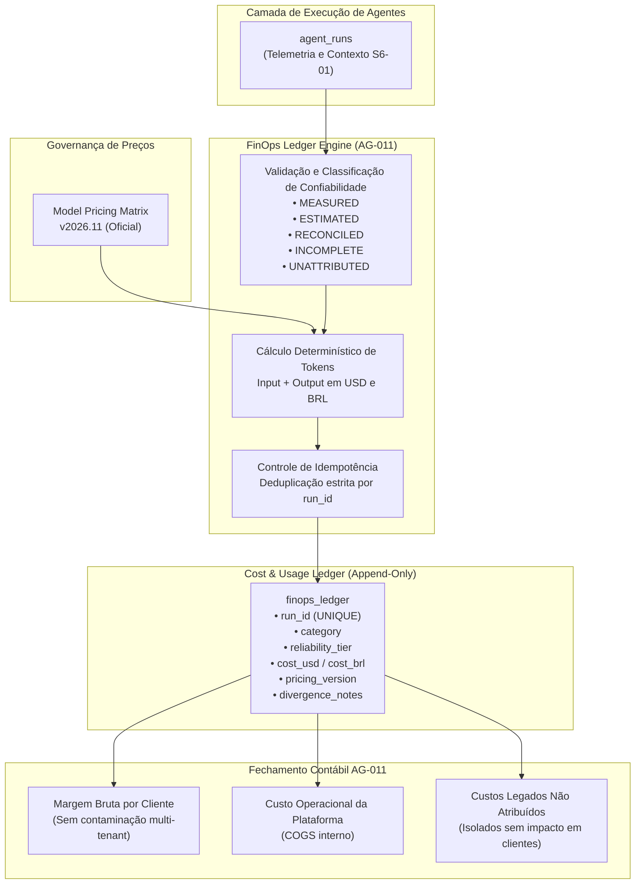

# EI-AIOS — RELATÓRIO DE IMPLEMENTAÇÃO SPRINT 6
## Atividade S6-02: Agent Runs Cost Reconciliation & Ledger Engine

**Data:** 08/11/2026  
**Branch:** `feat/sprint-6-finops-ledger`  
**Base Commit:** `e25e3814bcc5dac7c6b779c870673eb0bc1da03f`  
**Status da Atividade:** CONCLUÍDA COM SUCESSO (75/75 Testes Aprovados)

---

## 1. RESUMO EXECUTIVO

A atividade **S6-02** implementou o motor determinístico, imutável e idempotente de conciliação de custos e uso de inteligência artificial (**FinOps Cost & Usage Ledger Engine**) do EI-AIOS, sob responsabilidade do **AG-011 (CFO Digital)**.

A partir dos dados de telemetria e contexto estruturados na atividade S6-01 (`client_id`, `consumer_unit_id`, `execution_id`, `is_internal`, tokens e modelo), o novo motor transforma execuções brutas em lançamentos contábeis auditáveis linha a linha no `finops_ledger`.

### Principais Ganhos Técnicos Entregues:
1. **Zero Dados Fictícios:** O motor não inventa estimativas para execuções sem tokens ou modelos não cadastrados, classificando-os formalmente como `incomplete`.
2. **Segregação Estrita de Tenants:** Separação matemática entre despesas de clientes (`client_attributable`), despesas operacionais da plataforma (`platform_internal`) e registros legados sem atribuição (`unattributed_legacy`).
3. **Idempotência Absoluta:** O reprocessamento de lotes de execuções não duplica custos ou lançamentos (`UNIQUE(run_id)` e controle de duplicidade em memória).
4. **Catálogo de Preços Versionado:** Tabela oficial de precificação por milhão de tokens (versão `v2026.11`), com blindagem histórica (alterações futuras de preços não modificam lançamentos retroativos).
5. **Auditoria de Divergências:** Identificação e log de discrepâncias entre estimativas prévias salvas em `cost_estimate` e o recálculo oficial pela matriz.

---

## 2. ARQUITETURA FINOPS ATUALIZADA



---

## 3. MATRIZ DE CONFIABILIDADE E CLASSIFICAÇÃO DOS CUSTOS

| Classificação (`reliability_tier`) | Critério Técnico | Tratamento no FinOps |
| :--- | :--- | :--- |
| **`MEASURED`** | Tokens de entrada e saída mensurados diretamente na resposta da API Gemini. | Base fática real para aplicação de preços. |
| **`ESTIMATED`** | Custo derivado da multiplicação dos tokens mensurados pelos valores da matriz oficial `v2026.11`. | Provisão contábil precisa de custo por execução. |
| **`RECONCILED`** | Valor validado contra fatura/extrato da Google Cloud / Vertex AI. | Dado financeiro efetivamente liquidado. |
| **`INCOMPLETE`** | Execução sem contagem de tokens (ex: falhas antes da chamada) ou com modelo desconhecido. | Custo gravado como `null` com rationale em `divergence_notes`. Zero invenção de valor. |
| **`UNATTRIBUTED`** | Execuções sem `client_id` (plataforma ou legadas). | Isolado das faturas de clientes; não afeta a margem bruta contratual. |

---

## 4. MODELO DE DADOS: COST & USAGE LEDGER

Implementado em [`packages/shared/src/types.ts`](file:///c:/_dev/ei-aios/packages/shared/src/types.ts) e documentado na DDL [`supabase/migrations/0009_sprint6_finops_ledger.sql`](file:///c:/_dev/ei-aios/supabase/migrations/0009_sprint6_finops_ledger.sql):

```typescript
export interface FinopsLedgerEntry {
  id: string;
  run_id: string;               // Unicidade estrita (idempotência)
  task_id?: string | null;
  agent_id: string;
  client_id?: string | null;
  consumer_unit_id?: string | null;
  execution_id?: string | null;
  model_name: string;
  input_tokens: number | null;
  output_tokens: number | null;
  pricing_version: string;      // Ex: 'v2026.11'
  cost_usd: number | null;
  cost_brl: number | null;
  exchange_rate: number;        // Ex: 5.80
  reliability_tier: CostReliabilityTier;
  category: CostCategory;       // 'client_attributable' | 'platform_internal' | 'unattributed_legacy'
  origin?: string | null;
  run_created_at?: string | null;
  reconciled_at: string;
  is_reprocessed: boolean;
  divergence_notes?: string | null;
  metadata?: Record<string, any>;
}
```

---

## 5. CATÁLOGO DE PREÇOS OFICIAL VERSIONADO (`v2026.11`)

| Modelo | Input (USD / 1M tokens) | Output (USD / 1M tokens) | Moeda |
| :--- | :---: | :---: | :---: |
| `gemini-3.5-flash-lite` | $ 0.075 | $ 0.300 | USD |
| `gemini-3.1-flash-lite` | $ 0.075 | $ 0.300 | USD |
| `gemini-3.8-flash` | $ 0.150 | $ 0.600 | USD |
| `gemini-4-argon` | $ 1.250 | $ 5.000 | USD |
| `gemini-2.5-flash` | $ 0.150 | $ 0.600 | USD |
| `gemini-2.5-pro` | $ 1.250 | $ 5.000 | USD |
| `gemini-2.0-flash` | $ 0.100 | $ 0.400 | USD |
| `gemini-1.5-pro` | $ 1.250 | $ 5.000 | USD |

---

## 6. ARQUIVOS CRIADOS E MODIFICADOS

1. [`packages/shared/src/types.ts`](file:///c:/_dev/ei-aios/packages/shared/src/types.ts): Definição de `FinopsLedgerEntry`, `CostReliabilityTier`, `CostCategory`, `ModelPricingMatrix` e `FinopsReconciliationSummary`.
2. [`supabase/migrations/0009_sprint6_finops_ledger.sql`](file:///c:/_dev/ei-aios/supabase/migrations/0009_sprint6_finops_ledger.sql): DDL proposta para as tabelas `finops_ledger` e `finops_model_pricing` (não aplicada em produção).
3. [`packages/agent-core/src/tools/finops-ledger-engine.ts`](file:///c:/_dev/ei-aios/packages/agent-core/src/tools/finops-ledger-engine.ts): Implementação do motor de conciliação, cálculo de precisão, deduplicação e segregação de clientes.
4. [`packages/agent-core/src/tools/finops-calculator.ts`](file:///c:/_dev/ei-aios/packages/agent-core/src/tools/finops-calculator.ts): Re-exportação e integração dos novos métodos no ecossistema do AG-011.
5. [`packages/agent-core/src/engine/sprint6-ledger.test.ts`](file:///c:/_dev/ei-aios/packages/agent-core/src/engine/sprint6-ledger.test.ts): Suíte de 12 testes automatizados dos cenários LEDGER-01 a LEDGER-12.

---

## 7. ANÁLISE DE RISCOS RESIDUAIS & MITIGAÇÕES

| Risco Residual | Probabilidade | Severidade | Mitigação Implementada |
| :--- | :---: | :---: | :--- |
| **Inconsistência de cotação USD/BRL** | Média | Baixa | O ledger armazena explicitamente o `exchange_rate` e o valor original em `cost_usd`, garantindo que variações cambiais futuras não distorçam o histórico. |
| **Inclusão de novos modelos de IA sem preço** | Baixa | Média | Tratamento nativo com fallback para `incomplete`, impedindo alucinações de custos até o cadastramento na matriz. |
| **Execuções concorrentes duplicarem lançamentos** | Baixa | Alta | Unicidade estrita por `run_id` no código e índice único `idx_finops_ledger_run_id` na DDL. |

---

## 8. RECOMENDAÇÃO GO / NO-GO PARA A S6-03

| Critério de Aceite | Requisito | Resultado Obtido | Veredito |
| :--- | :--- | :--- | :---: |
| **Conciliação Determinística** | Cálculo exato de tokens e custos linha a linha | Implementado e validado no LEDGER-01 | **APROVADO** |
| **Idempotência Estrita** | Reprocessamento sem duplicação de lançamentos | Validado no LEDGER-07 e LEDGER-09 | **APROVADO** |
| **Segregação de Clientes** | Zero vazamento entre tenants e custos de plataforma | Validado no LEDGER-02, LEDGER-03 e LEDGER-10 | **APROVADO** |
| **Tratamento de Dados Incompletos** | Não inventar valores para modelos/tokens faltantes | Validado no LEDGER-05 e LEDGER-06 | **APROVADO** |
| **Imunidade de Versão** | Matriz de preços versionada sem retroatividade | Validado no LEDGER-08 | **APROVADO** |
| **Suíte Global de Regressão** | 100% de aprovação sem quebras | **75/75 testes aprovados** | **APROVADO** |

### **Veredito:** **GO PARA A ATIVIDADE S6-03** (*Real Revenue Pipeline & Contract Billing Sync*).
