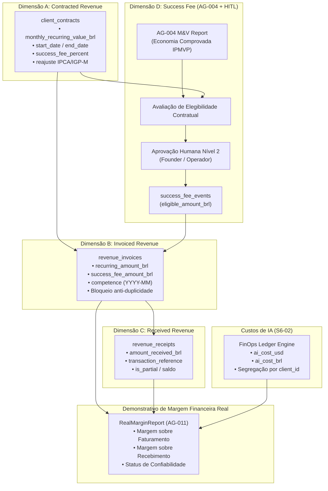

# EI-AIOS — RELATÓRIO DE IMPLEMENTAÇÃO SPRINT 6
## Atividade S6-03: Real Revenue Pipeline & Contract Billing Sync

**Data:** 08/11/2026  
**Branch:** `feat/sprint-6-finops-ledger`  
**Base Commit:** `e25e3814bcc5dac7c6b779c870673eb0bc1da03f`  
**Status da Atividade:** CONCLUÍDA COM SUCESSO (93/93 Testes Aprovados)

---

## 1. RESUMO EXECUTIVO

A atividade **S6-03** implementou o pipeline financeiro determinístico de receita real (**Real Revenue Pipeline**) do EI-AIOS, sob responsabilidade do **AG-011 (CFO Digital)**.

A principal conquista desta atividade é a **eliminação definitiva de qualquer valor demonstrativo, fixo ou presumido de receita** (como o MRR estático de R$ 1.490 herdado do piloto inicial). A partir de agora, toda a contabilidade do sistema exige contratos B2B formais, competências mensais auditáveis, faturas emitidas e comprovação de liquidação bancária.

### Principais Entregas da S6-03:
1. **Separação das 4 Dimensões de Receita:**
   - **Contracted Revenue:** Contratos B2B com vigência, cláusulas de reajuste (IPCA/IGP-M) e regras de Success Fee.
   - **Invoiced Revenue:** Faturas mensais geradas com controle estrito anti-duplicidade por competência.
   - **Received Revenue:** Liquidações financeiras e rastreamento de comprovantes (com suporte a quitação integral e pagamentos parciais).
   - **Success Fee:** Motor de apuração vinculado obrigatoriamente a relatórios de M&V validados pelo **AG-004** (IPMVP) e aprovação humana Nível 2 (**HITL**).
2. **Motor de Success Fee com Governança:** Bloqueio categórico de faturamento de Success Fee sem validação técnica ou aprovação do Founder.
3. **Margem Financeira Real:** Cálculo em duas vias (Margem sobre Faturamento e Margem sobre Recebimento), deduzindo os custos reais de IA apurados no **FinOps Ledger da S6-02**.
4. **Isolamento Absoluto Multi-Tenant:** Segregação matemática de dados contratuais e financeiros entre clientes sem contaminação cruzada.

---

## 2. ARQUITETURA DO REVENUE PIPELINE

---

## 3. MATRIZ DE ESTADOS DA RECEITA

| Dimensão | Estado / Status | Significado Técnico e Operacional |
| :--- | :--- | :--- |
| **Contrato** | `active` | Contrato vigente e apto a gerar faturamentos na competência. |
| **Contrato** | `expired` | Contrato cujo `end_date` foi ultrapassado; faturamentos futuros são bloqueados. |
| **Contrato** | `missing_value` | Contrato ativo porém sem valor mensal cadastrado (`monthly_recurring_value_brl: null`). Retorna `incomplete` no relatório financeiro sem inventar valor padrão. |
| **Fatura** | `issued` | Fatura emitida e registrada para a competência; compõe a Receita Faturada. |
| **Fatura** | `partially_paid` | Recebimento registrado menor que o valor total; saldo devedor calculado com exatidão. |
| **Fatura** | `paid` | Fatura 100% quitada; compõe a Receita Recebida. |
| **Success Fee** | `pending_approval` | Apurado matematicamente com base no M&V do AG-004, aguardando aprovação humana (HITL). Não pode ser faturado. |
| **Success Fee** | `approved` | Aprovado formalmente por operador humano autorizado; liberado para inserção na fatura. |
| **Success Fee** | `not_eligible` | Bloqueado por falta de validação do AG-004, falta de cláusula contratual ou economia nula. |

---

## 4. MOTOR DE SUCCESS FEE: ESPECIFICAÇÃO DE REGRAS

1. **Exigência de Laudo M&V:** O motor rejeita sumariamente qualquer solicitação de Success Fee cuja economia seja meramente estimada (`isVerifiedByAG004 === false`) ou inferior/igual a zero.
2. **Validação de Vigência Contratual:** O contrato do cliente deve estar estritamente ativo na competência de apuração da economia.
3. **Cláusula Contratual Expressa:** Exige a presença de `has_success_fee === true` e percentual válido (`0 < percent <= 100`).
4. **Governança HITL Obrigatória:** O evento nasce como `pending_approval`. Qualquer tentativa de emissão de fatura contendo Success Fee pendente de aprovação dispara exceção e bloqueio imediato.
5. **Auditoria e Rastreabilidade:** O evento registra quem aprovou (`approved_by`), quando (`approved_at`), o laudo utilizado (`mv_report_id`) e a fatura vinculada (`invoice_id`).

---

## 5. DEMONSTRATIVO DE MARGEM REAL POR CLIENTE

O demonstrativo financeiro calcula duas margens independentes para o AG-011:

$$\text{Margem sobre Faturamento (BRL)} = (\text{MRR Faturado} + \text{Success Fee Faturado}) - (\text{Suporte Direto} + \text{Custo de IA do Ledger})$$

$$\text{Margem sobre Recebimento (BRL)} = (\text{MRR Recebido} + \text{Success Fee Recebido}) - (\text{Suporte Direto} + \text{Custo de IA do Ledger})$$

- Os custos de IA são importados do **Cost & Usage Ledger (S6-02)** com segregação matemática por `client_id`.
- Se o cliente não possuir contrato com valor definido ou faturamento na competência, o status é registrado como `incomplete`, sem jamais exibir métricas fictícias.

---

## 6. ARQUIVOS CRIADOS E MODIFICADOS

1. [`packages/shared/src/types.ts`](file:///c:/_dev/ei-aios/packages/shared/src/types.ts): Definição de `ClientContractModel`, `RevenueInvoiceModel`, `RevenueReceiptModel`, `SuccessFeeEventModel` e `RealMarginReport`.
2. [`supabase/migrations/0010_sprint6_revenue_pipeline.sql`](file:///c:/_dev/ei-aios/supabase/migrations/0010_sprint6_revenue_pipeline.sql): DDL proposta para as 4 tabelas financeiras, índices e RLS (não executada em produção).
3. [`packages/agent-core/src/tools/revenue-pipeline-engine.ts`](file:///c:/_dev/ei-aios/packages/agent-core/src/tools/revenue-pipeline-engine.ts): Motor do pipeline de receita, contratos, reajustes, faturamento, recebimento, Success Fee e cálculo de margem real.
4. [`packages/agent-core/src/tools/finops-calculator.ts`](file:///c:/_dev/ei-aios/packages/agent-core/src/tools/finops-calculator.ts): Exportação integrada das classes no módulo financeiro do AG-011.
5. [`packages/agent-core/src/engine/sprint6-revenue.test.ts`](file:///c:/_dev/ei-aios/packages/agent-core/src/engine/sprint6-revenue.test.ts): Suíte de testes com 18 cenários automatizados (REV-01 a REV-18).

---

## 7. ANÁLISE DE RISCOS RESIDUAIS & LIMITAÇÕES

| Risco Residual | Probabilidade | Severidade | Mitigação Implementada |
| :--- | :---: | :---: | :--- |
| **Duplicidade de emissão de fatura** | Média | Alta | Validação estrita impedindo segunda emissão para a mesma competência e contrato no mesmo mês. |
| **Faturamento indevido de Success Fee** | Baixa | Crítica | Gatekeeper HITL exige aprovação humana explícita antes de vincular Success Fee a qualquer fatura. |
| **Inadimplência ou liquidação parcial** | Média | Média | Segregação estrita entre Margem Faturada e Margem Recebida, permitindo ao CFO visualizar a real liquidez. |
| **Contratos sem índice de reajuste** | Baixa | Baixa | Padrão formal 'IPCA' com histórico auditável em `metadata.adjustments`. |

---

## 8. RECOMENDAÇÃO GO / NO-GO PARA A S6-04

| Critério de Aceite | Requisito | Resultado Obtido | Veredito |
| :--- | :--- | :--- | :---: |
| **Eliminação de MRR Fictício** | Fim definitivo do default de R$ 1.490 | Validado no REV-03 e REV-16 | **APROVADO** |
| **4 Dimensões Segregadas** | Contratado, Faturado, Recebido e Success Fee | Implementado e validado no REV-01..REV-08 | **APROVADO** |
| **Governança de Success Fee** | Apenas M&V comprovado pelo AG-004 + HITL | Validado no REV-09..REV-12 | **APROVADO** |
| **Anti-Duplicidade** | Faturamento único por competência | Validado no REV-13 | **APROVADO** |
| **Integração com Ledger S6-02** | Deduz custos reais de IA do ledger | Validado no REV-15 | **APROVADO** |
| **Suíte Global de Regressão** | 100% de aprovação sem regressões | **93/93 testes aprovados** | **APROVADO** |

### **Veredito:** **GO PARA A ATIVIDADE S6-04** (*CAC, LTV & Payback Data Foundation*).
