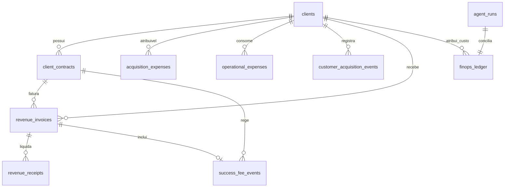

# EI-AIOS — MODELO DE DADOS FINANCEIRO SPRINT 6
## S6-04: CAC, LTV & Payback Data Foundation

---

## 1. DIAGRAMA ENTIDADE-RELACIONAMENTO (FINANCEIRO & FINOPS)

---

## 2. ESPECIFICAÇÃO DE TABELAS

### 2.1 `acquisition_expenses` (Despesas de Vendas e Marketing)
- `id` (UUID PK): Identificador único do lançamento.
- `tenant_id` (TEXT): Chave de partição multi-tenant.
- `client_id` (UUID FK nullable): Cliente atribuível, se a despesa for nominal.
- `campaign_id` (TEXT nullable): Campanha de marketing (ex: 'GoogleAds-Solar-Q4').
- `category` (TEXT): `SALES`, `MARKETING`, `ADVERTISING`, `SALES_COMMISSIONS`, `LEAD_GENERATION`, `EVENTS`, `CUSTOMER_ACQUISITION_TOOLS`, `OTHER_ACQUISITION`.
- `description` (TEXT): Descritivo auditável do gasto.
- `amount_brl` (NUMERIC 14,2): Valor em Reais.
- `competence` (TEXT): Formato YYYY-MM.
- `payment_date` (DATE): Data da liquidação financeira.
- `document_reference` (TEXT): Número da NF, contrato ou comprovante fiscal.
- `registered_by` (TEXT): Usuário ou agente que registrou o gasto.
- `validation_status` (TEXT): `validated`, `pending`, `rejected`.
- `is_shared` (BOOLEAN): Sinaliza despesa compartilhada entre múltiplos clientes.
- `history` (JSONB): Trilha de auditoria cronológica de alterações no lançamento.

### 2.2 `operational_expenses` (Custos Operacionais e Suporte - COGS)
- `id` (UUID PK): Identificador único.
- `tenant_id` (TEXT): Multi-tenant ID.
- `client_id` (UUID FK nullable): Cliente beneficiário.
- `consumer_unit_id` (UUID FK nullable): Unidade consumidora atendida.
- `contract_id` (UUID FK nullable): Contrato vinculado.
- `category` (TEXT): `ONBOARDING`, `IMPLEMENTATION`, `CUSTOMER_SUPPORT`, `OPERATIONAL_SERVICE`, `THIRD_PARTY_SERVICE`, `CUSTOMER_SPECIFIC_INFRASTRUCTURE`, `OTHER_COGS`.
- `description` (TEXT): Descrição do serviço prestado.
- `amount_brl` (NUMERIC 14,2): Custo operacional incorrido.
- `competence` (TEXT): YYYY-MM.
- `payment_date` (DATE): Data do pagamento/provisão.
- `validation_status` (TEXT): `validated`, `pending`, `rejected`.

### 2.3 `customer_acquisition_events` (Marcos Formais de Aquisição)
- `id` (UUID PK): Identificador do evento.
- `client_id` (UUID FK): Cliente adquirido.
- `tenant_id` (TEXT): Multi-tenant ID.
- `acquisition_date` (DATE): Data do fechamento/assinatura comercial.
- `contract_id` (UUID FK nullable): Contrato gerador.
- `channel` (TEXT): Canal de origem (ex: Inbound, Indicação, Outbound).
- `initial_mrr_brl` (NUMERIC 14,2): Receita recorrente acordada inicialmente.

### 2.4 `financial_metric_snapshots` (Snapshots Históricos do AG-011)
- `id` (UUID PK): Identificador do snapshot.
- `tenant_id` (TEXT): Multi-tenant ID.
- `metric_type` (TEXT): `CAC`, `LTV`, `PAYBACK`, `MARGIN_SUMMARY`.
- `client_id` (UUID FK nullable): Cliente (se métrica individual).
- `window_days` (INTEGER nullable): Janela de apuração (30, 60, 90).
- `metric_value` (NUMERIC 14,2): Valor apurado.
- `status` (TEXT): `measured`, `estimated`, `incomplete`, `unattributed`, `reconciled`.
- `methodology` (TEXT): Metodologia e premissas utilizadas.
- `metadata` (JSONB): Detalhamento dos identificadores e lançamentos inclusos.
