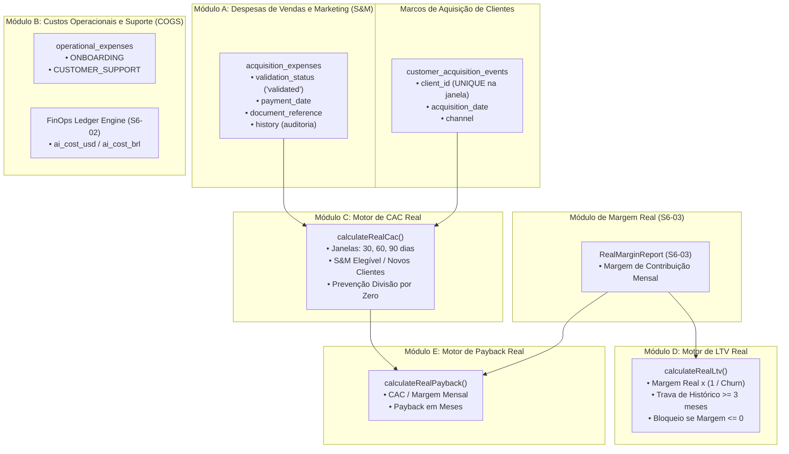

# EI-AIOS — RELATÓRIO DE IMPLEMENTAÇÃO SPRINT 6
## Atividade S6-04: CAC, LTV & Payback Data Foundation

**Data:** 08/11/2026  
**Branch:** `feat/sprint-6-finops-ledger`  
**Base Commit:** `e25e3814bcc5dac7c6b779c870673eb0bc1da03f`  
**Status da Atividade:** CONCLUÍDA COM SUCESSO (111/111 Testes Aprovados)

---

## 1. RESUMO EXECUTIVO

A atividade **S6-04** estruturou a fundação técnica e contábil de **Unit Economics** do EI-AIOS, sob governança do **AG-011 (CFO Digital)**.

O objetivo central foi eliminar a ausência histórica de dados que mantinha os indicadores de **CAC**, **LTV** e **Payback** no status `incomplete`. A partir desta entrega, o sistema conta com estruturas auditáveis para ingestão de despesas de aquisição (Sales & Marketing), custos operacionais de suporte (COGS), registro formal de aquisição de clientes e cálculos matemáticos determinísticos em janelas temporais configuráveis (30, 60 e 90 dias).

### Principais Entregas da S6-04:
1. **Estrutura de Despesas de Aquisição (S&M):** 8 categorias formais (`SALES`, `MARKETING`, `ADVERTISING`, `COMMISSIONS`, etc.) com rastreamento de comprovantes fiscais, responsável e trilha de auditoria para alterações de valores.
2. **Estrutura de Custos Operacionais (COGS):** Mapeamento de despesas diretas de onboarding e suporte por cliente e competência, integradas aos custos de IA apurados no **Cost & Usage Ledger (S6-02)**.
3. **Cálculo Auditável de CAC:** Janelas de 30, 60 e 90 dias, com prevenção nativa contra divisão por zero, deduplicação de clientes e bloqueio de despesas não validadas ou sem evidência.
4. **Fundação Real de LTV:** Vinculação estrita à margem de contribuição real apurada na **S6-03** e à taxa de churn observada, recusando margens nulas ou negativas e exigindo histórico mínimo confiável (>= 3 meses).
5. **Fundação Real de Payback:** Cálculo exato do tempo de recuperação do CAC (meses) baseado em margem real positiva.
6. **DDL Proposta:** Migration `0011_sprint6_unit_economics.sql` versionada com tabelas, índices e RLS.

---

## 2. ARQUITETURA DO MOTOR DE UNIT ECONOMICS

---

## 3. PRINCIPAIS REGRAS DE GOVERNANÇA IMPLEMENTADAS

1. **Anti-Divisão por Zero:** Se nenhum cliente foi adquirido na janela, o CAC retorna `null` com status `incomplete` e justificativa auditável registrada em `limitation_notes`.
2. **Exigência de Comprovação Fiscal:** Despesas com `validation_status === 'pending'` ou `'rejected'` não compõem o cálculo do CAC no tier `measured`.
3. **Despesas Compartilhadas:** Despesas marcadas como `is_shared: true` são ignoradas para o cálculo de cliente específico enquanto não houver regra de rateio formal e versionada.
4. **Imunidade contra MRR Fictício:** LTV e Payback recusam estimativas baseadas nos R$ 1.490 demonstrativos; se o cliente tiver margem nula ou negativa, o cálculo é bloqueado como `incomplete`.
5. **Histórico Mínimo de Vida Útil:** Exige ao menos 3 meses de histórico operacional do cliente antes de gerar projeções de LTV.
6. **Auditoria Contínua:** Alterações manuais em despesas geram snapshots em `history` com autor, motivo, valores antes e depois e timestamp.

---

## 4. ARQUIVOS CRIADOS E MODIFICADOS

1. [`packages/shared/src/types.ts`](file:///c:/_dev/ei-aios/packages/shared/src/types.ts): Definição de `AcquisitionExpenseModel`, `OperationalExpenseModel`, `CustomerAcquisitionEvent`, `RealCacResult`, `RealLtvResult` e `RealPaybackResult`.
2. [`supabase/migrations/0011_sprint6_unit_economics.sql`](file:///c:/_dev/ei-aios/supabase/migrations/0011_sprint6_unit_economics.sql): DDL proposta para as tabelas de Unit Economics (não aplicada em produção).
3. [`packages/agent-core/src/tools/unit-economics-engine.ts`](file:///c:/_dev/ei-aios/packages/agent-core/src/tools/unit-economics-engine.ts): Motor determinístico de cálculo de CAC, LTV e Payback.
4. [`packages/agent-core/src/tools/finops-calculator.ts`](file:///c:/_dev/ei-aios/packages/agent-core/src/tools/finops-calculator.ts): Exportação integrada do motor no AG-011.
5. [`packages/agent-core/src/engine/sprint6-unit-economics.test.ts`](file:///c:/_dev/ei-aios/packages/agent-core/src/engine/sprint6-unit-economics.test.ts): Suíte de testes com 18 cenários automatizados (UE-CAC-01 a UE-SEC-01).
6. [`docs/EI_AIOS_S6_04_DATA_MODEL.md`](file:///c:/_dev/ei-aios/docs/EI_AIOS_S6_04_DATA_MODEL.md): Documento de especificação do modelo de dados.
7. [`docs/EI_AIOS_S6_04_FINANCIAL_METRICS_SPEC.md`](file:///c:/_dev/ei-aios/docs/EI_AIOS_S6_04_FINANCIAL_METRICS_SPEC.md): Especificação matemática e regulatória das métricas.

---

## 5. RECOMENDAÇÃO GO / NO-GO PARA A S6-05

| Critério de Aceite | Requisito | Resultado Obtido | Veredito |
| :--- | :--- | :--- | :---: |
| **Ingestão S&M** | Despesas de aquisição com categorias e comprovantes | Implementado e testado no UE-CAC-01 | **APROVADO** |
| **Ingestão COGS** | Despesas de onboarding e suporte vinculadas a clientes | Implementado e testado no UE-OP-01..02 | **APROVADO** |
| **CAC Auditável** | Janelas de 30, 60 e 90 dias com prevenção de divisão por zero | Validado no UE-CAC-01..03 | **APROVADO** |
| **LTV Baseado em Margem Real** | Consome margem real da S6-03 sem dados fictícios | Validado no UE-LTV-01..03 | **APROVADO** |
| **Payback Real** | Razão CAC / Margem de Contribuição mensal | Validado no UE-PAY-01..02 | **APROVADO** |
| **Isolamento Multi-Tenant** | Despesas de um tenant não afetam outros | Validado no UE-CAC-09 e UE-SEC-01 | **APROVADO** |
| **Suíte Global de Regressão** | 100% de aprovação sem regressões | **111/111 testes aprovados** | **APROVADO** |

### **Veredito:** **GO PARA A ATIVIDADE S6-05** (*Observability Ledger Dashboard*).
