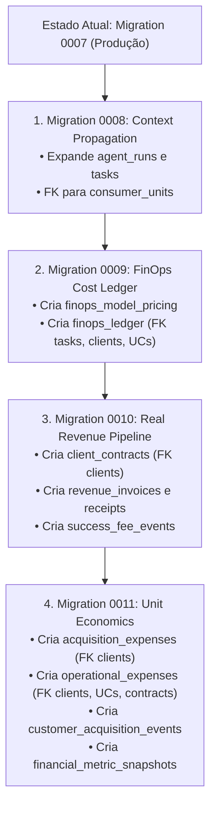

# EI-AIOS — PLANO SEQUENCIAL DE MIGRATIONS v1.6
## Procedimento de Execução Idempotente e Segura das Migrations 0008 a 0011

**Projeto:** Energy Intelligence AIOS (EI-AIOS)  
**Banco Alvo:** Supabase PostgreSQL (Produção / Staging)  
**Versão Alvo:** Release v1.6  
**Data:** 08/11/2026  
**Status:** PRONTO PARA EXECUÇÃO ASSISTIDA (Não executar sem autorização expressa)

---

## 1. ORDEM CRONOLÓGICA E DEPENDÊNCIAS DE SCHEMA

As migrations da Release v1.6 devem ser executadas estritamente na seguinte ordem sequencial:



---

## 2. DETALHAMENTO DE CADA ETAPA DE MIGRAÇÃO

### Etapa 1: Migration `0008_sprint6_context_propagation.sql`
- **Arquivo:** `supabase/migrations/0008_sprint6_context_propagation.sql`
- **Objetivo:** Adicionar metadados operacionais e financeiros em `agent_runs` e `tasks`.
- **Ações DDL:**
  * `ALTER TABLE agent_runs ADD COLUMN IF NOT EXISTS consumer_unit_id UUID REFERENCES consumer_units(id) ON DELETE SET NULL;`
  * `ALTER TABLE agent_runs ADD COLUMN IF NOT EXISTS execution_id VARCHAR(120);`
  * `ALTER TABLE agent_runs ADD COLUMN IF NOT EXISTS is_internal BOOLEAN NOT NULL DEFAULT false;`
  * `ALTER TABLE agent_runs ADD COLUMN IF NOT EXISTS metadata JSONB NOT NULL DEFAULT '{}'::jsonb;`
  * `ALTER TABLE tasks ADD COLUMN IF NOT EXISTS consumer_unit_id UUID REFERENCES consumer_units(id) ON DELETE SET NULL;`
  * Criação de 4 índices de busca: `idx_agent_runs_consumer_unit`, `idx_agent_runs_execution_id`, `idx_agent_runs_is_internal`, `idx_tasks_consumer_unit`.
- **Análise de Risco:** Risco quase nulo. A adição de colunas com default estático no PostgreSQL 11+ não bloqueia leituras ou escritas.

### Etapa 2: Migration `0009_sprint6_finops_ledger.sql`
- **Arquivo:** `supabase/migrations/0009_sprint6_finops_ledger.sql`
- **Objetivo:** Criar o catálogo de preços e o ledger contábil de execuções de IA.
- **Ações DDL:**
  * `CREATE TABLE IF NOT EXISTS finops_model_pricing (...)`
  * Seed idempotente da versão `v2026.11` com preços por milhão de tokens.
  * `CREATE TABLE IF NOT EXISTS finops_ledger (...)`
  * Criação de índices para consultas e integridade (`run_id` UNIQUE, `client_id`, `category`, `reliability_tier`).
  * Ativação e configuração de RLS (`service_role` e `authenticated`).
- **Análise de Risco:** Risco zero. Criação de tabelas novas sem interferência em tabelas legadas.

### Etapa 3: Migration `0010_sprint6_revenue_pipeline.sql`
- **Arquivo:** `supabase/migrations/0010_sprint6_revenue_pipeline.sql`
- **Objetivo:** Criar a estrutura de contratos B2B, faturamento por competência, recebimentos e Success Fee.
- **Ações DDL:**
  * `CREATE TABLE IF NOT EXISTS client_contracts (...)` (FK `clients`).
  * `CREATE TABLE IF NOT EXISTS revenue_invoices (...)` (FK `client_contracts`, `clients`).
  * `CREATE TABLE IF NOT EXISTS revenue_receipts (...)` (FK `revenue_invoices`, `clients`).
  * `CREATE TABLE IF NOT EXISTS success_fee_events (...)` (FK `client_contracts`, `clients`).
  * Criação de índices estratégicos de busca por competência e status.
  * Ativação e configuração de políticas RLS.
- **Análise de Risco:** Risco zero. Estrutura relacional estritamente append-only.

### Etapa 4: Migration `0011_sprint6_unit_economics.sql`
- **Arquivo:** `supabase/migrations/0011_sprint6_unit_economics.sql`
- **Objetivo:** Criar a fundação contábil para despesas de aquisição (S&M), custos de suporte (COGS), aquisições de clientes e snapshots.
- **Ações DDL:**
  * `CREATE TABLE IF NOT EXISTS acquisition_expenses (...)` (FK `clients`).
  * `CREATE TABLE IF NOT EXISTS operational_expenses (...)` (FK `clients`, `consumer_units`, `client_contracts`).
  * `CREATE TABLE IF NOT EXISTS customer_acquisition_events (...)` (FK `clients`, `client_contracts`).
  * `CREATE TABLE IF NOT EXISTS financial_metric_snapshots (...)` (FK `clients`).
  * Criação de índices para filtragem por `tenant_id`, competência e data de pagamento.
  * Ativação e configuração de políticas RLS.
- **Análise de Risco:** Risco zero.

---

## 3. PROCEDIMENTO DE EXECUÇÃO TRANSAIONAL RECOMENDADO

Recomenda-se aplicar as migrações via Supabase CLI ou SQL Editor em bloco transacional único:

```sql
BEGIN;

-- 1. Migration 0008
\i supabase/migrations/0008_sprint6_context_propagation.sql

-- 2. Migration 0009
\i supabase/migrations/0009_sprint6_finops_ledger.sql

-- 3. Migration 0010
\i supabase/migrations/0010_sprint6_revenue_pipeline.sql

-- 4. Migration 0011
\i supabase/migrations/0011_sprint6_unit_economics.sql

COMMIT;
```

---

## 4. VERIFICAÇÃO PÓS-MIGRAÇÃO (SMOKE QUERIES)

```sql
-- 1. Verifica se as colunas de contexto existem em agent_runs
SELECT column_name, data_type FROM information_schema.columns
WHERE table_name = 'agent_runs' AND column_name IN ('consumer_unit_id', 'execution_id', 'is_internal');

-- 2. Verifica se a tabela de preços de IA possui os 8 modelos semeados
SELECT model_name, input_usd_per_million, output_usd_per_million FROM finops_model_pricing WHERE version_id = 'v2026.11';

-- 3. Verifica integridade das tabelas de receita e unit economics
SELECT table_name FROM information_schema.tables
WHERE table_name IN ('client_contracts', 'revenue_invoices', 'revenue_receipts', 'success_fee_events', 'acquisition_expenses', 'operational_expenses');
```
