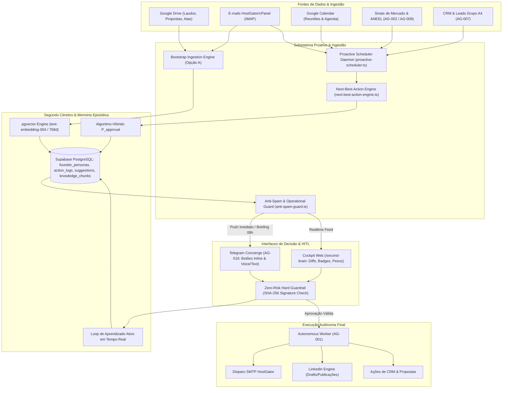
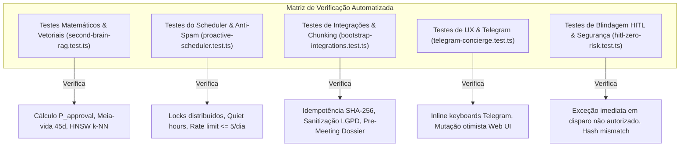

# ESPECIFICAÇÃO TÉCNICA DE ENGENHARIA: SEGUNDO CÉREBRO & MEMÓRIA EPISÓDICA DO FUNDADOR (EI-AIOS)

**Documento:** Especificação Técnica Oficial de Arquitetura e Implementação  
**Data:** 17 de Novembro de 2026  
**Status:** Consolidado e Auditado  
**Autores do Planejamento:**  
- Auditor & Integrador Geral (`plan_auditor`)  
- Especialista em RAG & Memória Episódica (`rag_lead`)  
- Especialista em Automação Proativa & Scheduler (`sched_lead`)  
- Especialista em Integrações Externas & Bootstrap (`integrator`)  
- Especialista em UX Cockpit & Telegram Concierge (`cockpit_ux`)  
**Repositório Alvo:** `c:/_Dev/ei-aios`  
**Destinatário:** Coordenador do Swarm & Fundador da Energy Intelligence

---

## 1. VISÃO GERAL & ARQUITETURA EXECUTIVA

### 1.1 Objetivo do Segundo Cérebro
O ecossistema **EI-AIOS** evolui de um orquestrador operacional reativo para um **Segundo Cérebro Autônomo e Cognitivo** do fundador solo da Energy Intelligence. O sistema atua como um clone executivo de alto desempenho com os seguintes objetivos:
1. **Antecipar Ações (Next-Best-Action)**: Monitorar continuamente e-mails corporativos (`AG-012`), pipeline de vendas no CRM (`AG-007`), movimentações de concorrentes e despachos regulatórios ANEEL (`AG-002`/`AG-009`) e agenda (`Google Calendar`).
2. **Memória Episódica Fiel**: Registrar cada intervenção humana (aprovação, edição de texto, ajuste de preço, descarte e justificativas), construindo um banco vetorial de precedentes históricos em subespaço semântico de 768 dimensões (`pgvector`).
3. **Cálculo Determinístico de Probabilidade de Aprovação ($P_{approval}$)**: Decompor matematicamente a aderência de cada sugestão preditiva antes de exibi-la ao fundador.
4. **Governança Zero-Risk HITL (Human-in-the-Loop)**: Blindagem técnica pétrea impedindo qualquer ação externa (disparo de e-mails, postagens em redes sociais, envio de propostas) sem assinatura e autorização explícita do fundador.
5. **Experiência Multiplataforma**: Decisão em menos de 5 segundos via **Telegram Concierge (`AG-016`)** com inline keyboards e resposta por voz/texto, ou análise aprofundada via **Cockpit Web (`/second-brain`)** com visualizador de diff semântico e decomposição analítica de scores.

### 1.2 Diagrama Arquitetural de Alto Nível



---

## 2. ESQUEMA DE BANCO DE DADOS: DDL `0017_founder_second_brain.sql`

O banco de dados utiliza a extensão `pgvector` sobre o PostgreSQL 15+ gerenciado via Supabase. A migração cria tabelas determinísticas, índices vetoriais HNSW e funções de consulta por produto escalar / similaridade de cosseno.

```sql
-- ==============================================================================
-- MIGRATION 0017: SEGUNDO CÉREBRO & MEMÓRIA EPISÓDICA DO FUNDADOR (EI-AIOS)
-- ==============================================================================

SET search_path = public;

-- 1. HABILITAÇÃO DA EXTENSÃO DE VETORES
CREATE EXTENSION IF NOT EXISTS vector;

-- 2. TABELA DE PERSONAS E DIRETRIZES ESTRATÉGICAS DO FUNDADOR
CREATE TABLE IF NOT EXISTS founder_personas (
  id UUID PRIMARY KEY DEFAULT gen_random_uuid(),
  name VARCHAR(120) NOT NULL,
  slug VARCHAR(80) UNIQUE NOT NULL,
  description TEXT NOT NULL,
  is_active BOOLEAN NOT NULL DEFAULT false,
  risk_tolerance VARCHAR(30) NOT NULL DEFAULT 'balanced' 
    CHECK (risk_tolerance IN ('conservative', 'balanced', 'growth_aggressive')),
  preferred_tone VARCHAR(40) NOT NULL DEFAULT 'analytical_executive',
  decision_weights JSONB NOT NULL DEFAULT '{
    "vector_similarity_weight": 0.45,
    "business_rules_weight": 0.35,
    "temporal_freshness_weight": 0.20,
    "auto_approval_threshold": 0.90,
    "review_warning_threshold": 0.65
  }',
  business_heuristics JSONB NOT NULL DEFAULT '{
    "min_success_fee_percent": 20.0,
    "max_monthly_churn_risk_usd": 500.0,
    "target_distributors": ["CPFL Paulista", "Enel SP", "Elektro", "Cemig"],
    "prohibited_claim_keywords": ["garantia incondicional", "sem risco", "economia garantida"],
    "max_daily_telegram_pushes": 5,
    "quiet_hours_start": "21:00",
    "quiet_hours_end": "07:30"
  }',
  created_at TIMESTAMPTZ NOT NULL DEFAULT NOW(),
  updated_at TIMESTAMPTZ NOT NULL DEFAULT NOW()
);

-- 3. TABELA DE CONHECIMENTO BASE & HISTÓRICO (BOOTSTRAP OPÇÃO A)
CREATE TABLE IF NOT EXISTS knowledge_chunks (
  id UUID PRIMARY KEY DEFAULT gen_random_uuid(),
  source_type VARCHAR(40) NOT NULL, -- 'google_drive', 'email', 'regulatory_source', 'internal_artifact'
  source_id VARCHAR(255) NOT NULL,
  chunk_index INTEGER NOT NULL DEFAULT 0,
  content TEXT NOT NULL,
  content_checksum VARCHAR(64) NOT NULL, -- SHA-256 para idempotência
  metadata JSONB NOT NULL DEFAULT '{}',
  embedding vector(768),
  created_at TIMESTAMPTZ NOT NULL DEFAULT NOW()
);

-- 4. TABELA DE MEMÓRIA EPISÓDICA (AÇÕES, REJEIÇÕES E EDIÇÕES DO FUNDADOR)
CREATE TABLE IF NOT EXISTS founder_action_logs (
  id UUID PRIMARY KEY DEFAULT gen_random_uuid(),
  persona_id UUID REFERENCES founder_personas(id) ON DELETE SET NULL,
  agent_id VARCHAR(60) NOT NULL,
  action_type VARCHAR(40) NOT NULL 
    CHECK (action_type IN ('APPROVE', 'EDIT_AND_APPROVE', 'REJECT', 'DISCARD', 'OVERRIDE')),
  task_type VARCHAR(80) NOT NULL,
  target_entity_type VARCHAR(50),
  target_entity_id VARCHAR(120),
  original_proposal TEXT NOT NULL,
  final_executed_content TEXT,
  diff_summary JSONB,
  reasoning_feedback TEXT,
  rejection_category VARCHAR(60),
  proposal_embedding vector(768),
  final_content_embedding vector(768),
  confidence_score NUMERIC(5,4) NOT NULL DEFAULT 0.5000,
  execution_channel VARCHAR(40) NOT NULL DEFAULT 'web_cockpit',
  applied_heuristics JSONB NOT NULL DEFAULT '{}',
  created_at TIMESTAMPTZ NOT NULL DEFAULT NOW()
);

-- 5. TABELA DE SUGESTÕES PREDITIVAS (NEXT-BEST-ACTION FEED)
CREATE TABLE IF NOT EXISTS predictive_suggestions (
  id UUID PRIMARY KEY DEFAULT gen_random_uuid(),
  persona_id UUID REFERENCES founder_personas(id) ON DELETE SET NULL,
  category VARCHAR(50) NOT NULL, -- 'email_response', 'crm_followup', 'market_opportunity', 'calendar_prep', 'tariff_optimization', 'social_post', 'governance_alert'
  priority VARCHAR(10) NOT NULL DEFAULT 'P2' CHECK (priority IN ('P0', 'P1', 'P2', 'P3')),
  title VARCHAR(255) NOT NULL,
  context_summary TEXT NOT NULL,
  action_type VARCHAR(80) NOT NULL,
  target_agent_id VARCHAR(60) NOT NULL,
  target_entity_type VARCHAR(50),
  target_entity_id VARCHAR(120),
  action_payload JSONB NOT NULL,
  confidence_score NUMERIC(5,4) NOT NULL DEFAULT 0.0000,
  approval_probability NUMERIC(5,4) NOT NULL DEFAULT 0.0000,
  score_breakdown JSONB NOT NULL DEFAULT '{}',
  dedup_fingerprint VARCHAR(64) NOT NULL, -- SHA-256 para deduplicação
  status VARCHAR(30) NOT NULL DEFAULT 'pending' 
    CHECK (status IN ('pending', 'accepted', 'edited', 'rejected', 'expired')),
  feedback_payload JSONB,
  expires_at TIMESTAMPTZ NOT NULL,
  created_at TIMESTAMPTZ NOT NULL DEFAULT NOW(),
  updated_at TIMESTAMPTZ NOT NULL DEFAULT NOW()
);

-- 6. TABELA DE CONTROLE DE LOCKS DISTRIBUÍDOS DO SCHEDULER
CREATE TABLE IF NOT EXISTS scheduler_locks (
  job_name VARCHAR(100) PRIMARY KEY,
  locked_until TIMESTAMPTZ NOT NULL,
  locked_by VARCHAR(120) NOT NULL,
  updated_at TIMESTAMPTZ NOT NULL DEFAULT NOW()
);

-- 7. ÍNDICES DE PERFORMANCE E PESQUISA VETORIAL HNSW (768 DIMENSÕES)
CREATE INDEX IF NOT EXISTS idx_knowledge_chunks_embedding_hnsw 
  ON knowledge_chunks USING hnsw (embedding vector_cosine_ops)
  WITH (m = 16, ef_construction = 64);

CREATE INDEX IF NOT EXISTS idx_knowledge_chunks_checksum 
  ON knowledge_chunks(content_checksum);

CREATE INDEX IF NOT EXISTS idx_founder_action_logs_proposal_embedding_hnsw 
  ON founder_action_logs USING hnsw (proposal_embedding vector_cosine_ops)
  WITH (m = 16, ef_construction = 64);

CREATE INDEX IF NOT EXISTS idx_founder_action_logs_created_agent 
  ON founder_action_logs(agent_id, created_at DESC);

CREATE INDEX IF NOT EXISTS idx_predictive_suggestions_status_priority 
  ON predictive_suggestions(status, priority, created_at DESC);

CREATE INDEX IF NOT EXISTS idx_predictive_suggestions_dedup 
  ON predictive_suggestions(dedup_fingerprint, status);

-- 8. FUNÇÕES RPC DE SIMILARIDADE VETORIAL
CREATE OR REPLACE FUNCTION match_founder_episodes (
  query_embedding vector(768),
  match_threshold double precision,
  match_count integer,
  filter_agent_id varchar DEFAULT NULL
)
RETURNS TABLE (
  id uuid,
  agent_id varchar,
  action_type varchar,
  task_type varchar,
  original_proposal text,
  final_executed_content text,
  reasoning_feedback text,
  similarity double precision,
  created_at timestamptz
)
LANGUAGE plpgsql
STABLE
AS $$
BEGIN
  RETURN QUERY
  SELECT
    fal.id,
    fal.agent_id,
    fal.action_type,
    fal.task_type,
    fal.original_proposal,
    fal.final_executed_content,
    fal.reasoning_feedback,
    1.0 - (fal.proposal_embedding <=> query_embedding) AS similarity,
    fal.created_at
  FROM founder_action_logs fal
  WHERE 
    fal.proposal_embedding IS NOT NULL
    AND (filter_agent_id IS NULL OR fal.agent_id = filter_agent_id)
    AND (1.0 - (fal.proposal_embedding <=> query_embedding)) >= match_threshold
  ORDER JOIN fal.proposal_embedding <=> query_embedding
  LIMIT match_count;
END;
$$;

CREATE OR REPLACE FUNCTION match_knowledge_chunks (
  query_embedding vector(768),
  match_threshold double precision,
  match_count integer,
  filter_source_type varchar DEFAULT NULL
)
RETURNS TABLE (
  id uuid,
  source_type varchar,
  source_id varchar,
  chunk_index integer,
  content text,
  metadata jsonb,
  similarity double precision
)
LANGUAGE plpgsql
STABLE
AS $$
BEGIN
  RETURN QUERY
  SELECT
    kc.id,
    kc.source_type,
    kc.source_id,
    kc.chunk_index,
    kc.content,
    kc.metadata,
    1.0 - (kc.embedding <=> query_embedding) AS similarity
  FROM knowledge_chunks kc
  WHERE 
    kc.embedding IS NOT NULL
    AND (filter_source_type IS NULL OR kc.source_type = filter_source_type)
    AND (1.0 - (kc.embedding <=> query_embedding)) >= match_threshold
  ORDER BY kc.embedding <=> query_embedding
  LIMIT match_count;
END;
$$;
```

---

## 3. FORMULAÇÃO MATEMÁTICA: ALGORITMO DE PROBABILIDADE DE APROVAÇÃO ($P_{approval}$)

O motor calcula a probabilidade preditiva de que o fundador aprove uma proposta gerada sem necessitar de intervenções corretivas profundas.

### 3.1 Fórmula Canônica
A probabilidade $P_{approval} \in [0.0, 1.0]$ é obtida por:

$$P_{approval} = \left( w_v \cdot S_{vector} + w_r \cdot C_{rules} + w_t \cdot T_{time} \right) \times \prod_{i=1}^{k} H_i$$

Onde:
- **$S_{vector} \in [0, 1]$**: Similaridade Semântica Ponderada pelo Histórico de Episódios
- **$C_{rules} \in [0, 1]$**: Índice de Coerência com Heurísticas de Negócio
- **$T_{time} \in [0, 1]$**: Taxa Temporal Recente de Aceite do Agente (Laplace-smoothed)
- **$w_v, w_r, w_t$**: Pesos normalizados da Persona Ativa ($w_v + w_r + w_t = 1.0$)
- **$\prod H_i \in \{0, 1\}$**: Guardrails Pétreos Determinísticos (Hard Constraints)

### 3.2 Componente 1: Similaridade Vetorial Temporal ($S_{vector}$)
Dado o vetor de embedding da nova proposta $\vec{e}_{prop} \in \mathbb{R}^{768}$, resgatamos os top-$K$ ($K=10$) episódios mais similares no banco. Para cada episódio $j \in \{1, \dots, K\}$:

$$s_j = \frac{\vec{e}_{prop} \cdot \vec{e}_j}{\|\vec{e}_{prop}\| \|\vec{e}_j\|}$$

Calcula-se o peso temporal com decaimento exponencial ($t_{half-life} = 45\text{ dias}$):

$$\lambda = \frac{\ln(2)}{45 \times 86400} \approx 1.782 \times 10^{-7}\text{ s}^{-1}$$

$$\omega_j = e^{-\lambda \cdot \Delta t_j}$$

O multiplicador da ação histórica $a_j$:
- $a_j = +1.0$ para `APPROVE`
- $a_j = +0.70$ para `EDIT_AND_APPROVE` (quando similaridade de texto $\ge 0.70$)
- $a_j = -0.80$ para `REJECT` ou `DISCARD`

$$S_{vector} = \text{clamp}\left(0.50 + \frac{\sum_{j=1}^K \omega_j \cdot s_j \cdot a_j}{2 \cdot \sum_{j=1}^K \omega_j},\, 0.0,\, 1.0\right)$$

### 3.3 Componente 2: Conformidade com Regras de Negócio ($C_{rules}$)
Avaliador determinístico sem LLM:
- **Margem de Honorários**: Se `successFeePercent` $< 20.0\%$, penalidade imediata de $-0.40$.
- **Território de Concessionárias**: Se fora de CPFL, Enel, Elektro, Cemig, penalidade de $-0.15$.
- **Termos Vetados**: Presença de expressões vedadas ("economia garantida", "sem risco"), penalidade imediata de $-0.50$.
- $C_{rules} = \max(0.0,\, 1.0 - \sum \text{penalidades})$.

### 3.4 Componente 3: Peso Temporal do Agente ($T_{time}$)
Taxa recente (últimos 14 dias) de aceitação do agente proponente com suavização de Laplace:

$$T_{time} = \frac{N_{aprovados\_14d} + 1}{N_{total\_14d} + 2}$$

### 3.5 Guardrails Pétreos ($H_i \in \{0, 1\}$)
Se qualquer uma das condições abaixo for violada, $\prod H_i = 0$, forçando $P_{approval} = 0.0000$:
1. $H_1$: Violação da Resolução Normativa ANEEL nº 1.000/2021 ou Lei 14.300/2022.
2. $H_2$: Tentativa de envio externo autônomo sem passar pela fila de aprovação HITL.
3. $H_3$: Alteração no payload de ação durante o trânsito (divergência de hash SHA-256).

### 3.6 Limiares Operacionais
- **$P_{approval} \ge 0.90$ (Alta Confiança / Badge Esmeralda)**: Pré-autorizado para apresentação prioritária.
- **$0.65 \le P_{approval} < 0.90$ (Média Confiança / Badge Céu)**: Apresentação normal com destaque dos pontos de cautela.
- **$P_{approval} < 0.65$ (Baixa Confiança / Badge Âmbar)**: Alerta explícito de risco; requer revisão minuciosa.

---

## 4. LOOP DE APRENDIZADO ATIVO EM TEMPO REAL (ACTIVE LEARNING)

Quando o fundador toma uma ação decisória no Web Cockpit ou no Telegram, o sistema executa um ciclo de aprendizado síncrono com latência $< 250\text{ms}$:

```mermaid
sequenceDiagram
    autonumber
    actor Founder as Fundador
    participant UI as Telegram / Web Cockpit
    participant Service as FounderSecondBrainService
    participant LLM as Gemini Embeddings / Flash
    participant DB as Supabase PostgreSQL

    Founder->>UI: Executa Ação (Aprovar / Editar / Rejeitar)
    UI->>Service: recordActionAndLearn(actionData)
    
    rect rgb(20, 30, 45)
        Note over Service: 1. Extração de Diferenças (Diff Myers)
        Service->>Service: computeContentDiff(original, final)
    end

    rect rgb(30, 40, 35)
        Note over Service: 2. Vetorização Semântica
        Service->>LLM: Embeddings (Gemini text-embedding-004)
        LLM-->>Service: Vectors (768 dims)
    end

    rect rgb(45, 30, 20)
        Note over Service: 3. Auto-Reflexão & Heurísticas
        Service->>LLM: Analisa Delta Semântico (se editado/rejeitado)
        LLM-->>Service: Nova Heurística Extraída
    end

    Service->>DB: INSERT INTO founder_action_logs
    Service->>DB: UPDATE founder_personas (business_heuristics)
    Service-->>UI: Confirmação & Atualização de Estado Realtime
```



### Detalhes do Pipeline de Aprendizado:
1. **Myers Diff & Semantic Delta**:
   - Compara o texto original gerado pelo agente com a versão final editada pelo fundador.
   - Computa delta de caracteres, contagem de tokens alterados e razão de similaridade textual.
2. **Auto-Reflexão sobre Rejeições e Ajustes**:
   - Caso `action_type == 'EDIT_AND_APPROVE'` ou `'REJECT'`, aciona o modelo rápido (Gemini 2.5 Flash) com prompt metacognitivo:
     > *"O fundador alterou a proposta de [...] para [...]. Qual regra, preferência de estilo ou critério de precificação foi aplicado? Responda em 1 frase acionável e formato JSON."*
3. **Persistência Atômica na Persona Ativa**:
   - A heurística extraída é incorporada ao campo `business_heuristics.learned_rules` da tabela `founder_personas`.

---

## 5. SUBSISTEMA DE AUTOMAÇÃO PROATIVA & SCHEDULER

O daemon é implementado em `packages/agent-core/src/engine/proactive-scheduler.ts` e roda acoplado ao runtime do Node 20.

### 5.1 Frequências e Watchers Periódicos
1. **Tick Central**: Avaliação a cada 60 segundos (`TICK_INTERVAL_MS = 60_000`) baseado no fuso `America/Sao_Paulo` (UTC-3).
2. **Cron Diário 08:00 AM (Morning Briefing Executivo)**:
   - Resumo da agenda do dia e reuniões com parceiros/clientes.
   - Destaque da sugestão preditiva #1 de maior impacto ($P_{approval} \ge 0.90$).
   - Pendências críticas HITL aguardando decisão.
   - Sinais regulatórios da noite (ANEEL).
3. **Cron Diário 18:30 PM (Evening Wrap-up)**:
   - Fechamento de interações diárias, follow-ups enviados e status do pipeline comercial.
4. **Email Watcher (a cada 15 min)**:
   - Varredura de caixas corporativas via IMAP HostGator (`AG-012`).
   - Detecção de e-mails de clientes Grupo A4 solicitando revisão de fatura ou cotação.
5. **CRM Watcher (a cada 1 hora)**:
   - Varredura de leads estagnados $> 48\text{h}$ no funil comercial (`AG-007`).
6. **Market Intelligence Watcher (2 vezes ao dia - 09:30 e 15:30)**:
   - Monitoramento de notícias e despachos do Diário Oficial da União (DOU/ANEEL) via `AG-002` e `AG-009`.
7. **Calendar Watcher (a cada 15 min)**:
   - Verificação de reuniões nas próximas 2 horas para disparar geração de **Dossiê Pré-Reunião**.

### 5.2 Resiliência Operacional & Anti-Spam Guard (`anti-spam-guard.ts`)
- **Deduplicação Determinística**: Fingerprint gerado via `SHA-256(agentId + entityType + entityId + actionType)`. Rejeita criação de sugestão idêntica pendente nos últimos 7 dias.
- **Janela de Silêncio (Quiet Hours)**: Das 21:00 às 07:30 (horário de Brasília). Notificações são enfileiradas e consolidadas no briefing das 08:00 AM, exceto prioridade emergencial **P0**.
- **Teto de Pushes**: Limite rigoroso de **no máximo 5 pushes Telegram/dia** para proteger o foco cognitivo do fundador.
- **Distributed Job Lease**: Registro em `scheduler_locks` para execução atômica sem concorrência entre réplicas.

---

## 6. INTEGRAÇÕES EXTERNAS & BOOTSTRAP DE CONHECIMENTO

### 6.1 Ingestão e Carga Inicial de Histórico (Bootstrap Opção A)
- **Google Drive (via `google-drive.ts`)**:
  - Reutiliza credenciais de Service Account JWT.
  - Varre pastas de laudos técnicos, propostas comerciais, estudos de viabilidade e atas de reunião.
  - Conversão inteligente: Docs/Textos para Markdown, PDFs para texto estruturado, planilhas para tabelas Markdown sumarizadas.
- **E-mails Corporativos (via `email-intelligence.ts`)**:
  - Conexão IMAP/TLS com HostGator cPanel.
  - Limpeza determinística de assinaturas, rodapés jurídicos e citações repetitivas de threads.
- **Sanitização Determinística & LGPD**:
  - Regex de mascaramento de CPFs, senhas, chaves de API e dados bancários.
  - Preservação intacta de identificadores setoriais: Unidades Consumidoras (UC), demandas contratadas (kW), consumos ponta/fora de ponta (kWh) e números de processos ANEEL.
- **Chunking Semântico**: Janela de 600 a 800 tokens com 100 tokens de sobreposição, respeitando títulos Markdown.
- **Armazenamento**: Tabela `knowledge_chunks` com checksum SHA-256 e embeddings Gemini de 768 dimensões.

### 6.2 Gestão de Agenda & Dossiês Pré-Reunião (`google-calendar.ts`)
- **Autenticação**: Google Calendar API v3 via OAuth2 / Service Account com escopo restrito (`calendar.readonly` / `calendar.events`).
- **Dossiê Pré-Reunião Automático (Pre-Meeting Intelligence)**:
  - Disparado 60 a 120 minutos antes de reuniões com participantes externos.
  - O sistema correlaciona o domínio do interlocutor com o CRM (`AG-007`), resgata faturas/laudos no RAG (`knowledge_chunks`) e histórico de e-mails (`AG-012`).
  - Gera documento sintético no Telegram/Cockpit com:
    - Perfil do interlocutor e empresa.
    - Diagnóstico de consumo e histórico de economia obtida.
    - 3 pontos de negociação recomendados (Talking Points).
    - Cautelas e riscos regulatórios associados à distribuidora local.

### 6.3 Gerador de Conteúdo para Mídias Sociais (LinkedIn Engine)
- **Origem de Sinais**: Despachos ANEEL (`AG-009`) e inteligência competitiva (`AG-002`).
- **Formatos Gerados**:
  1. *Análise Regulatória Traduzida*: Impactos práticos para indústrias e CFOs.
  2. *Estudo de Caso Anonimizado*: Engenharia matemática comprovando economia real sem expor dados do cliente.
  3. *Carrossel Executivo*: Roteiro estruturado para exportação via `SlideEngine` (Marp Markdown).
- **Governança Estrita**: Classificado como `social_media_draft`. Nunca disparado diretamente; exibido para aprovação do fundador com cópia fácil para a área de transferência.

---

## 7. INTERFACES DE USUÁRIO: COCKPIT WEB & TELEGRAM CONCIERGE

### 7.1 Cockpit Web (`/second-brain`)
- **Localização**: `packages/web-ui/src/app/(admin)/second-brain/page.tsx`
- **Design System**: Dark mode corporativo (Slate 950/900/800, Emerald 400/500, Sky 400, Amber 400).
- **Módulos da Interface**:
  1. **Fila Preditiva (Action Feed)**: Cards ordenados por urgência com badges de probabilidade decomposta ($P_{approval}$, similaridade, regras, frescor).
  2. **Visualizador de Myers Diff**: Exibição lado a lado ou unificada de trechos modificados antes de confirmar a execução.
  3. **Memória Episódica & RAG**: Busca e inspeção dos precedentes históricos que justificaram a pontuação da sugestão.
  4. **Calibração de Persona**: Sliders para ajuste dos pesos $w_v, w_r, w_t$ e edição de heurísticas de negócio.

### 7.2 Telegram Concierge (`AG-016`)
- **Mensagem Estruturada de Push**:
  ```text
  🧠 SEGUNDO CÉREBRO | NOVO INSIGHT [P1]
  📌 Responder E-mail: Proposta Grupo A4 - TecnoMetal
  🎯 Agente: AG-012 (Email Intelligence)
  📊 Probabilidade de Aprovação: 94.2% (Excelente)

  📝 Rascunho da Resposta:
  "Prezado Carlos, analisamos seu histórico tarifário na CPFL Paulista. Identificamos um potencial de redução de 18.4% na demanda contratada..."

  [✅ Aprovar & Enviar] [✏️ Ajustar] [❌ Descartar]
  ```
- **Fluxo Interativo de Edição**:
  - Ao clicar em `[✏️ Ajustar]`, o bot entra no estado conversacional `AWAITING_EDIT_INPUT`.
  - O fundador envia mensagem de áudio ou texto: *"Mude o percentual para 15% e mencione a reunião de terça"*.
  - O LLM aplica as alterações, regera o rascunho e apresenta nova confirmação inline.

### 7.3 Regra Pétrea HITL de Risco Zero
- **Mecanismo de Validação Criptográfica**:
  1. Ao gerar a sugestão, calcula-se o hash `SHA-256(action_payload)`.
  2. A fila do `AutonomousWorker` valida se o hash recebido coincide exatamente com a sugestão aprovada pelo fundador.
  3. Qualquer divergência aborta a execução imediatamente com disparo de alerta crítico de integridade.

---

## 8. CONTRATOS DE DADOS TYPESCRIPT & ESPECIFICAÇÃO DE APIS

### 8.1 Interfaces TypeScript Unificadas (`packages/shared/src/types/second-brain.ts`)

```typescript
// packages/shared/src/types/second-brain.ts

export type SuggestionPriority = 'P0' | 'P1' | 'P2' | 'P3';
export type SuggestionStatus = 'pending' | 'accepted' | 'edited' | 'rejected' | 'expired';

export type SuggestionCategory =
  | 'email_response'
  | 'crm_followup'
  | 'market_opportunity'
  | 'calendar_prep'
  | 'tariff_optimization'
  | 'social_post'
  | 'governance_alert';

export interface ScoreBreakdown {
  vectorSimilarity: number;
  businessRules: number;
  temporalFreshness: number;
  weights: {
    wv: number;
    wr: number;
    wt: number;
  };
  hardGuardrailsPassed: boolean;
}

export interface PredictiveSuggestionPayload {
  action_name: string;
  recommended_agent_id: string;
  execution_route: 'autonomous_task' | 'telegram_reply' | 'email_smtp_send' | 'copy_to_clipboard';
  draft_text?: string;
  task_params?: Record<string, any>;
  source_evidence: string[];
}

export interface PredictiveSuggestion {
  id: string;
  persona_id?: string;
  category: SuggestionCategory;
  priority: SuggestionPriority;
  title: string;
  context_summary: string;
  action_type: string;
  target_agent_id: string;
  target_entity_type?: string;
  target_entity_id?: string;
  action_payload: PredictiveSuggestionPayload;
  confidence_score: number;
  approval_probability: number;
  score_breakdown: ScoreBreakdown;
  dedup_fingerprint: string;
  status: SuggestionStatus;
  feedback_payload?: {
    action: 'accepted' | 'edited' | 'rejected';
    reason?: string;
    edited_text?: string;
    decided_at: string;
  };
  expires_at: string;
  created_at: string;
  updated_at: string;
}

export interface FounderPersona {
  id: string;
  name: string;
  slug: string;
  description: string;
  isActive: boolean;
  riskTolerance: 'conservative' | 'balanced' | 'growth_aggressive';
  preferredTone: string;
  decisionWeights: {
    vectorSimilarityWeight: number;
    businessRulesWeight: number;
    temporalFreshnessWeight: number;
    autoApprovalThreshold: number;
    reviewWarningThreshold: number;
  };
  businessHeuristics: {
    min_success_fee_percent: number;
    target_distributors: string[];
    prohibited_claim_keywords: string[];
    max_daily_telegram_pushes: number;
    quiet_hours_start: string;
    quiet_hours_end: string;
    learned_rules?: string[];
  };
  createdAt: string;
  updatedAt: string;
}

export interface ActionLogEntry {
  id: string;
  personaId?: string;
  agentId: string;
  actionType: 'APPROVE' | 'EDIT_AND_APPROVE' | 'REJECT' | 'DISCARD' | 'OVERRIDE';
  taskType: string;
  targetEntityType?: string;
  targetEntityId?: string;
  originalProposal: string;
  finalExecutedContent?: string;
  diffSummary?: {
    charCountDelta: number;
    tokenCountDelta: number;
    similarityRatio: number;
    changesDetected: string[];
  };
  reasoningFeedback?: string;
  rejectionCategory?: string;
  confidenceScore: number;
  executionChannel: string;
  appliedHeuristics: Record<string, any>;
  createdAt: string;
}
```

### 8.2 Rotas de API REST (`packages/agent-core/src/api/routes.ts`)

| Método | Endpoint | Descrição |
|---|---|---|
| `GET` | `/api/v1/second-brain/suggestions` | Lista sugestões preditivas pendentes com filtros e paginação |
| `POST` | `/api/v1/second-brain/suggestions/:id/accept` | Aprova e despacha ação da sugestão |
| `POST` | `/api/v1/second-brain/suggestions/:id/edit` | Salva versão editada pelo fundador e executa |
| `POST` | `/api/v1/second-brain/suggestions/:id/reject` | Descarta sugestão com justificativa |
| `GET` | `/api/v1/second-brain/personas/active` | Retorna persona ativa e parâmetros de decisão |
| `PUT` | `/api/v1/second-brain/personas/:id/weights` | Calibra pesos matemáticos da persona |
| `GET` | `/api/v1/second-brain/scheduler/status` | Retorna status dos daemons e locks ativos |
| `POST` | `/api/v1/second-brain/scheduler/trigger-briefing`| Força geração do briefing matinal sob demanda |
| `POST` | `/api/v1/second-brain/bootstrap/start` | Inicia job assíncrono de bootstrap do Drive ou E-mails |
| `GET` | `/api/v1/second-brain/bootstrap/status/:jobId` | Acompanha progresso e tokens consumidos no bootstrap |
| `GET` | `/api/v1/second-brain/calendar/today` | Retorna agenda do dia e status de dossiês gerados |
| `POST` | `/api/v1/second-brain/calendar/dossier/:eventId` | Gera sob demanda o dossiê pré-reunião |
| `POST` | `/api/v1/second-brain/social/draft` | Gera rascunho de post para LinkedIn |

---

## 9. PLANO DE VERIFICAÇÃO, AUDITORIA & TESTES

A suíte de testes deve garantir 100% de confiabilidade matemática, resiliência contra falhas de rede e estrita segurança operacional.



### Critérios de Aceite para Conclusão:
1. **$P_{approval}$ Determinístico**: Simulação com dados sintéticos deve demonstrar isolamento dos pesos e corte a zero quando qualquer guardrail é violado.
2. **Zero-Risk Hard Guardrail**: Tentativa simulada de envio de e-mail sem autorização explícita ou com hash divergente deve disparar `ZeroRiskPolicyViolationException` e abortar a operação.
3. **Idempotência de Ingestão**: Re-execução da rotina de bootstrap sobre os mesmos arquivos do Google Drive deve resultar em 0 chamadas adicionais de embeddings via validação por SHA-256.
4. **Respeito a Quiet Hours**: Pushes gerados entre 21:00 e 07:30 que não sejam P0 devem ser retidos com sucesso para o lote das 08:00 AM.
5. **Compilação TypeScript Sem Erros**: Todos os módulos compartilhados em `packages/shared`, `packages/agent-core` e `packages/web-ui` devem compilar limpos com tipos estritos.

---

## 10. CRONOGRAMA DE IMPLEMENTAÇÃO EM FASES

1. **Fase 1 (Banco & RAG Episódico)**:
   - Aplicação da migração `0017_founder_second_brain.sql`.
   - Implementação de `founder-second-brain.ts` e cálculo de $P_{approval}$.
2. **Fase 2 (Scheduler Proativo & Anti-Spam)**:
   - Implementação de `proactive-scheduler.ts`, `next-best-action-engine.ts` e `anti-spam-guard.ts`.
   - Setup do Morning Briefing das 08:00 AM.
3. **Fase 3 (Bootstrap & Conectores Externos)**:
   - Implementação do extrator e sanitizador em `google-drive.ts` e `email-intelligence.ts`.
   - Implementação de `google-calendar.ts` e gerador de Dossiê Pré-Reunião.
4. **Fase 4 (Interfaces: Web Cockpit & Telegram Concierge)**:
   - Criação da página `/second-brain` no `packages/web-ui`.
   - Implementação da máquina de estados interativa no bot do Telegram (`AG-016`).
5. **Fase 5 (Testes Integrados & Auditoria Final)**:
   - Execução da suíte completa de testes automatizados e validação pelo fundador.
